# 形態模擬交易狀態

更新時間：11-28 12:40（台北時間）。每 4 小時自動更新一次。

全部是模擬資金，沒有真實下單，也不是投資建議。

完整互動圖表（可切換週期、篩選、看回測）：https://ashin047.github.io/pattern-paper-bot/

## 總覽

| 項目 | 數值 |
|---|---|
| 開始實測 | 11-25 16:05 |
| 已結束交易 | 54 筆 |
| 勝率 | 3.7% |
| 每筆平均 | -0.92R |
| 合計 | -49.6R |
| 持倉中 | 76 筆，26 個商品 |
| 持倉浮動損益合計 | -5.2R |
| 有交易的帳戶 | 18 / 160 |
| 全部帳戶合計損益 | -2,450 USDT |

## 持倉中

| 商品 | 帳戶 | 方向 | 進場時間 | 進場價 | 現價 | 目前止損 | 目標 | 浮動損益 |
|---|---|---|---|---|---|---|---|---|
| 1INCH | 三角向下跌破 | 做空 | 11-28 00:00 | 0.0572 | 0.0579 | 0.0593 | 0.0483 | -0.33R |
| 1INCH | 三角向下跌破｜四段 | 做空 | 11-28 00:00 | 0.0572 | 0.0579 | 0.0593 | 1R、2R、3R 各出 25%（已出 0 段） | -0.33R |
| ARB | 三角向上突破 | 做多 | 11-27 12:00 | 0.1166 | 0.1136 | 0.1099 | 0.1355 | -0.45R |
| ARB | 三角向上突破｜四段 | 做多 | 11-27 12:00 | 0.1166 | 0.1136 | 0.1099 | 1R、2R、3R 各出 25%（已出 0 段） | -0.45R |
| ATOM | 三角向下跌破 | 做空 | 11-27 00:00 | 1.189 | 1.219 | 1.276 | 1.016 | -0.34R |
| ATOM | 三角向下跌破｜四段 | 做空 | 11-27 00:00 | 1.189 | 1.219 | 1.276 | 1R、2R、3R 各出 25%（已出 0 段） | -0.34R |
| AVAX | 三角向上突破 | 做多 | 11-27 16:00 | 6.756 | 6.606 | 6.470 | 7.742 | -0.52R |
| AVAX | 三角向上突破｜四段 | 做多 | 11-27 16:00 | 6.756 | 6.606 | 6.470 | 1R、2R、3R 各出 25%（已出 0 段） | -0.52R |
| BAT | M頭 | 做空 | 11-25 20:00 | 0.0739 | 0.0743 | 0.0832 | 0.0654 | -0.04R |
| BAT | M頭｜四段 | 做空 | 11-25 20:00 | 0.0739 | 0.0743 | 0.0832 | 1R、2R、3R 各出 25%（已出 0 段） | -0.04R |
| BAT | 上升楔形 | 做空 | 11-28 00:00 | 0.0752 | 0.0743 | 0.0823 | 0.0663 | +0.13R |
| BAT | 上升楔形｜四段 | 做空 | 11-28 00:00 | 0.0752 | 0.0743 | 0.0823 | 1R、2R、3R 各出 25%（已出 0 段） | +0.13R |
| BAT | 上升楔形｜強勢 | 做空 | 11-28 00:00 | 0.0752 | 0.0743 | 0.0823 | 移動止損 | +0.13R |
| BAT | 上升楔形｜強勢四段 | 做空 | 11-28 00:00 | 0.0752 | 0.0743 | 0.0823 | 1R、2R、3R 各出 25%（已出 0 段） | +0.13R |
| DASH | 三角向上突破 | 做多 | 11-27 20:00 | 36.950 | 35.830 | 34.950 | 42.140 | -0.56R |
| DASH | 三角向上突破｜四段 | 做多 | 11-27 20:00 | 36.950 | 35.830 | 34.950 | 1R、2R、3R 各出 25%（已出 0 段） | -0.56R |
| DASH | 多頭旗形 | 做多 | 11-27 20:00 | 36.950 | 35.830 | 34.950 | 41.100 | -0.56R |
| DASH | 多頭旗形｜四段 | 做多 | 11-27 20:00 | 36.950 | 35.830 | 34.950 | 1R、2R、3R 各出 25%（已出 0 段） | -0.56R |
| ETH | 上升楔形 | 做空 | 11-28 08:00 | 1,662.5 | 1,666.0 | 1,755.2 | 1,541.3 | -0.04R |
| ETH | 上升楔形｜四段 | 做空 | 11-28 08:00 | 1,662.5 | 1,666.0 | 1,755.2 | 1R、2R、3R 各出 25%（已出 0 段） | -0.04R |
| FET | W底 | 做多 | 11-27 04:00 | 0.1209 | 0.1251 | 0.1005 | 0.14 | +0.21R |
| FET | W底｜四段 | 做多 | 11-27 04:00 | 0.1209 | 0.1251 | 0.1005 | 1R、2R、3R 各出 25%（已出 0 段） | +0.21R |
| FET | 三重底 | 做多 | 11-27 04:00 | 0.1209 | 0.1251 | 0.1005 | 0.14 | +0.21R |
| FET | 三重底｜四段 | 做多 | 11-27 04:00 | 0.1209 | 0.1251 | 0.1005 | 1R、2R、3R 各出 25%（已出 0 段） | +0.21R |
| GALA | 上升三角 | 做多 | 11-28 08:00 | 0.001434 | 0.00142 | 0.001229 | 0.001657 | -0.07R |
| GALA | 上升三角｜四段 | 做多 | 11-28 08:00 | 0.001434 | 0.00142 | 0.001229 | 1R、2R、3R 各出 25%（已出 0 段） | -0.07R |
| ICP | 三角向上突破 | 做多 | 11-27 12:00 | 2.057 | 2.017 | 1.957 | 2.308 | -0.40R |
| ICP | 三角向上突破｜四段 | 做多 | 11-27 12:00 | 2.057 | 2.017 | 1.957 | 1R、2R、3R 各出 25%（已出 0 段） | -0.40R |
| IOTA | 三角向上突破 | 做多 | 11-27 12:00 | 0.0327 | 0.0327 | 0.0312 | 0.0365 | +0.00R |
| IOTA | 三角向上突破｜四段 | 做多 | 11-27 12:00 | 0.0327 | 0.0327 | 0.0312 | 1R、2R、3R 各出 25%（已出 0 段） | +0.00R |
| IOTA | 多頭旗形 | 做多 | 11-27 12:00 | 0.0327 | 0.0327 | 0.0312 | 0.0356 | +0.00R |
| IOTA | 多頭旗形｜四段 | 做多 | 11-27 12:00 | 0.0327 | 0.0327 | 0.0312 | 1R、2R、3R 各出 25%（已出 0 段） | +0.00R |
| KAVA | 三角向上突破｜四段 | 做多 | 11-27 04:00 | 0.02488 | 0.02697 | 0.02559 | 1R、2R、3R 各出 25%（已出 3 段） | +2.06R |
| KAVA | 三角向上突破｜四段 | 做多 | 11-27 20:00 | 0.02636 | 0.02697 | 0.024 | 1R、2R、3R 各出 25%（已出 0 段） | +0.26R |
| KAVA | 三角向上突破｜強勢 | 做多 | 11-27 20:00 | 0.02636 | 0.02697 | 0.024 | 移動止損 | +0.26R |
| KAVA | 三角向上突破｜強勢四段 | 做多 | 11-27 20:00 | 0.02636 | 0.02697 | 0.024 | 1R、2R、3R 各出 25%（已出 0 段） | +0.26R |
| KAVA | 三角向上突破｜強勢｜8H | 做多 | 11-28 00:00 | 0.027 | 0.02724 | 0.02395 | 移動止損 | +0.08R |
| KAVA | 三角向上突破｜強勢四段｜8H | 做多 | 11-28 00:00 | 0.027 | 0.02724 | 0.02395 | 1R、2R、3R 各出 25%（已出 0 段） | +0.08R |
| LINK | W底 | 做多 | 11-27 16:00 | 9.599 | 9.239 | 8.463 | 10.694 | -0.32R |
| LINK | W底｜四段 | 做多 | 11-27 16:00 | 9.599 | 9.239 | 8.463 | 1R、2R、3R 各出 25%（已出 0 段） | -0.32R |
| LTC | 三角向上突破 | 做多 | 11-26 12:00 | 43.800 | 44.660 | 39.500 | 51.180 | +0.20R |
| LTC | 三角向上突破｜四段 | 做多 | 11-26 12:00 | 43.800 | 44.660 | 39.500 | 1R、2R、3R 各出 25%（已出 0 段） | +0.20R |
| LTC | 上升三角 | 做多 | 11-27 12:00 | 44.460 | 44.660 | 39.500 | 50.730 | +0.04R |
| LTC | 上升三角｜四段 | 做多 | 11-27 12:00 | 44.460 | 44.660 | 39.500 | 1R、2R、3R 各出 25%（已出 0 段） | +0.04R |
| OP | 三角向上突破 | 做多 | 11-27 12:00 | 0.071 | 0.0703 | 0.0681 | 0.0817 | -0.24R |
| OP | 三角向上突破｜四段 | 做多 | 11-27 12:00 | 0.071 | 0.0703 | 0.0681 | 1R、2R、3R 各出 25%（已出 0 段） | -0.24R |
| RUNE | 頭肩底 | 做多 | 11-26 08:00 | 0.549 | 0.569 | 0.496 | 0.6275 | +0.38R |
| RUNE | 頭肩底｜四段 | 做多 | 11-26 08:00 | 0.549 | 0.569 | 0.496 | 1R、2R、3R 各出 25%（已出 0 段） | +0.38R |
| RUNE | 上升三角 | 做多 | 11-26 08:00 | 0.549 | 0.569 | 0.496 | 0.627 | +0.38R |
| RUNE | 上升三角｜四段 | 做多 | 11-26 08:00 | 0.549 | 0.569 | 0.496 | 1R、2R、3R 各出 25%（已出 0 段） | +0.38R |
| SEI | W底｜強勢｜8H | 做多 | 11-27 00:00 | 0.03853 | 0.03848 | 0.03109 | 移動止損 | -0.01R |
| SEI | W底｜強勢四段｜8H | 做多 | 11-27 00:00 | 0.03853 | 0.03848 | 0.03109 | 1R、2R、3R 各出 25%（已出 0 段） | -0.01R |
| SNX | 三角向上突破 | 做多 | 11-28 08:00 | 0.1482 | 0.1437 | 0.1407 | 0.1771 | -0.60R |
| SNX | 三角向上突破｜四段 | 做多 | 11-28 08:00 | 0.1482 | 0.1437 | 0.1407 | 1R、2R、3R 各出 25%（已出 0 段） | -0.60R |
| SOL | 三角向上突破 | 做多 | 11-27 12:00 | 72.750 | 71.720 | 69.710 | 85.390 | -0.34R |
| SOL | 三角向上突破｜四段 | 做多 | 11-27 12:00 | 72.750 | 71.720 | 69.710 | 1R、2R、3R 各出 25%（已出 0 段） | -0.34R |
| SUI | 三角向上突破 | 做多 | 11-27 20:00 | 0.6892 | 0.6716 | 0.6496 | 0.8088 | -0.44R |
| SUI | 三角向上突破｜四段 | 做多 | 11-27 20:00 | 0.6892 | 0.6716 | 0.6496 | 1R、2R、3R 各出 25%（已出 0 段） | -0.44R |
| SUI | 多頭旗形 | 做多 | 11-27 20:00 | 0.6892 | 0.6716 | 0.6496 | 0.7599 | -0.44R |
| SUI | 多頭旗形｜四段 | 做多 | 11-27 20:00 | 0.6892 | 0.6716 | 0.6496 | 1R、2R、3R 各出 25%（已出 0 段） | -0.44R |
| SUSHI | 三角向下跌破 | 做空 | 11-28 00:00 | 0.1502 | 0.1503 | 0.1563 | 0.1377 | -0.02R |
| SUSHI | 三角向下跌破｜四段 | 做空 | 11-28 00:00 | 0.1502 | 0.1503 | 0.1563 | 1R、2R、3R 各出 25%（已出 0 段） | -0.02R |
| SUSHI | 三角向下跌破｜強勢 | 做空 | 11-28 00:00 | 0.1502 | 0.1503 | 0.1563 | 移動止損 | -0.02R |
| SUSHI | 三角向下跌破｜強勢四段 | 做空 | 11-28 00:00 | 0.1502 | 0.1503 | 0.1563 | 1R、2R、3R 各出 25%（已出 0 段） | -0.02R |
| UNI | 三角向上突破 | 做多 | 11-27 16:00 | 4.885 | 4.767 | 4.541 | 5.832 | -0.34R |
| UNI | 三角向上突破｜四段 | 做多 | 11-27 16:00 | 4.885 | 4.767 | 4.541 | 1R、2R、3R 各出 25%（已出 0 段） | -0.34R |
| VET | 三角向上突破 | 做多 | 11-27 12:00 | 0.004953 | 0.004994 | 0.004592 | 0.005449 | +0.11R |
| VET | 三角向上突破｜四段 | 做多 | 11-27 12:00 | 0.004953 | 0.004994 | 0.004592 | 1R、2R、3R 各出 25%（已出 0 段） | +0.11R |
| XTZ | 頭肩底 | 做多 | 11-27 04:00 | 0.2204 | 0.2273 | 0.2042 | 0.2487 | +0.43R |
| XTZ | 頭肩底｜四段 | 做多 | 11-27 04:00 | 0.2204 | 0.2273 | 0.2042 | 1R、2R、3R 各出 25%（已出 0 段） | +0.43R |
| ZIL | W底 | 做多 | 11-27 16:00 | 0.000884 | 0.000886 | 0.000796 | 0.000966 | +0.02R |
| ZIL | W底｜四段 | 做多 | 11-27 16:00 | 0.000884 | 0.000886 | 0.000796 | 1R、2R、3R 各出 25%（已出 0 段） | +0.02R |
| ZIL | 箱型向上突破 | 做多 | 11-27 16:00 | 0.000884 | 0.000886 | 0.000803 | 0.000968 | +0.03R |
| ZIL | 箱型向上突破｜四段 | 做多 | 11-27 16:00 | 0.000884 | 0.000886 | 0.000803 | 1R、2R、3R 各出 25%（已出 0 段） | +0.03R |
| ZRX | 上升三角 | 做多 | 11-28 08:00 | 0.0813 | 0.0805 | 0.0783 | 0.0886 | -0.27R |
| ZRX | 上升三角｜四段 | 做多 | 11-28 08:00 | 0.0813 | 0.0805 | 0.0783 | 1R、2R、3R 各出 25%（已出 0 段） | -0.27R |

## 持倉圖表

每筆持倉一張圖，用它自己的進場週期畫。黑色三角是進場的 K 棒，藍色底是持倉期間。

### 1INCH · 三角向下跌破 · 做空 · 浮動 -0.33R

4H 週期｜進場 11-28 00:00 @ 0.0572｜現價 0.0579｜目前止損 0.0593｜目標 0.0483

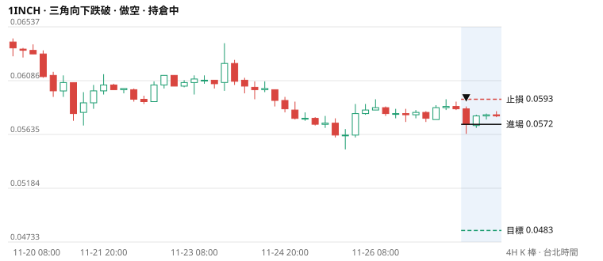

### 1INCH · 三角向下跌破｜四段 · 做空 · 浮動 -0.33R

4H 週期｜進場 11-28 00:00 @ 0.0572｜現價 0.0579｜目前止損 0.0593｜目標 1R、2R、3R 各出 25%（已出 0 段）

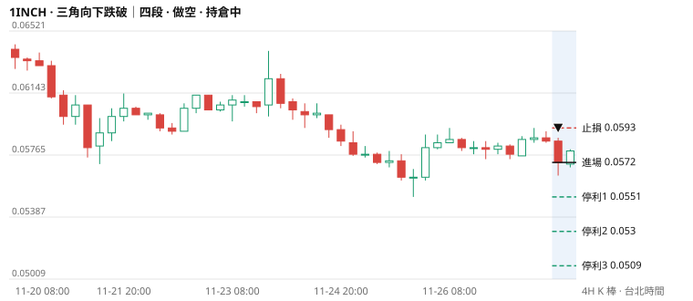

### ARB · 三角向上突破 · 做多 · 浮動 -0.45R

4H 週期｜進場 11-27 12:00 @ 0.1166｜現價 0.1136｜目前止損 0.1099｜目標 0.1355

### ARB · 三角向上突破｜四段 · 做多 · 浮動 -0.45R

4H 週期｜進場 11-27 12:00 @ 0.1166｜現價 0.1136｜目前止損 0.1099｜目標 1R、2R、3R 各出 25%（已出 0 段）

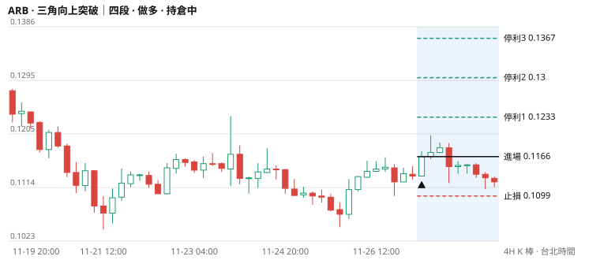

### ATOM · 三角向下跌破 · 做空 · 浮動 -0.34R

4H 週期｜進場 11-27 00:00 @ 1.189｜現價 1.219｜目前止損 1.276｜目標 1.016

### ATOM · 三角向下跌破｜四段 · 做空 · 浮動 -0.34R

4H 週期｜進場 11-27 00:00 @ 1.189｜現價 1.219｜目前止損 1.276｜目標 1R、2R、3R 各出 25%（已出 0 段）

### AVAX · 三角向上突破 · 做多 · 浮動 -0.52R

4H 週期｜進場 11-27 16:00 @ 6.756｜現價 6.606｜目前止損 6.470｜目標 7.742

### AVAX · 三角向上突破｜四段 · 做多 · 浮動 -0.52R

4H 週期｜進場 11-27 16:00 @ 6.756｜現價 6.606｜目前止損 6.470｜目標 1R、2R、3R 各出 25%（已出 0 段）

### BAT · M頭 · 做空 · 浮動 -0.04R

4H 週期｜進場 11-25 20:00 @ 0.0739｜現價 0.0743｜目前止損 0.0832｜目標 0.0654

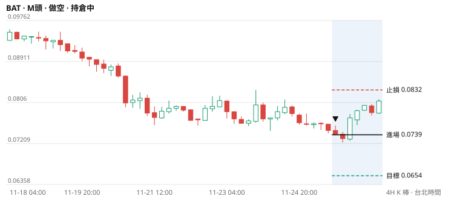

### BAT · M頭｜四段 · 做空 · 浮動 -0.04R

4H 週期｜進場 11-25 20:00 @ 0.0739｜現價 0.0743｜目前止損 0.0832｜目標 1R、2R、3R 各出 25%（已出 0 段）

### BAT · 上升楔形 · 做空 · 浮動 +0.13R

4H 週期｜進場 11-28 00:00 @ 0.0752｜現價 0.0743｜目前止損 0.0823｜目標 0.0663

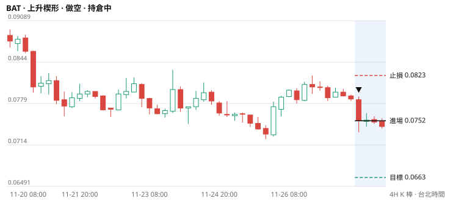

### BAT · 上升楔形｜四段 · 做空 · 浮動 +0.13R

4H 週期｜進場 11-28 00:00 @ 0.0752｜現價 0.0743｜目前止損 0.0823｜目標 1R、2R、3R 各出 25%（已出 0 段）

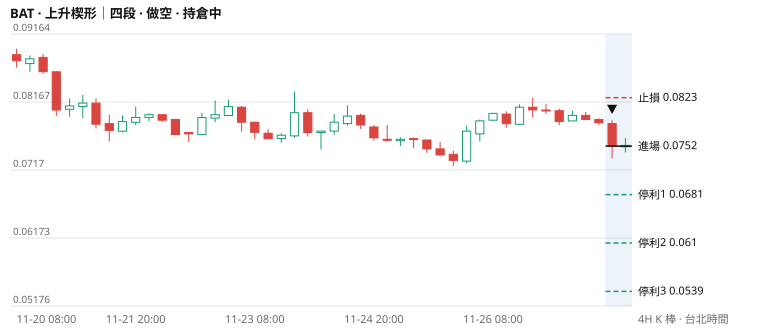

### BAT · 上升楔形｜強勢 · 做空 · 浮動 +0.13R

4H 週期｜進場 11-28 00:00 @ 0.0752｜現價 0.0743｜目前止損 0.0823｜目標 移動止損

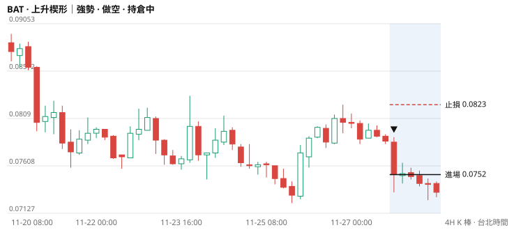

### BAT · 上升楔形｜強勢四段 · 做空 · 浮動 +0.13R

4H 週期｜進場 11-28 00:00 @ 0.0752｜現價 0.0743｜目前止損 0.0823｜目標 1R、2R、3R 各出 25%（已出 0 段）

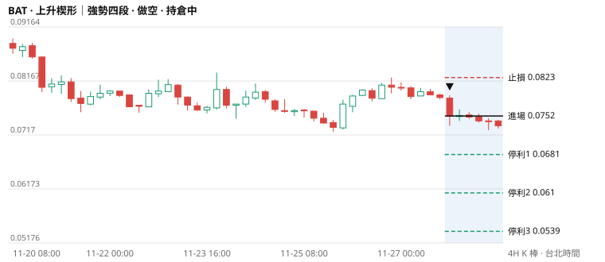

### DASH · 三角向上突破 · 做多 · 浮動 -0.56R

4H 週期｜進場 11-27 20:00 @ 36.950｜現價 35.830｜目前止損 34.950｜目標 42.140

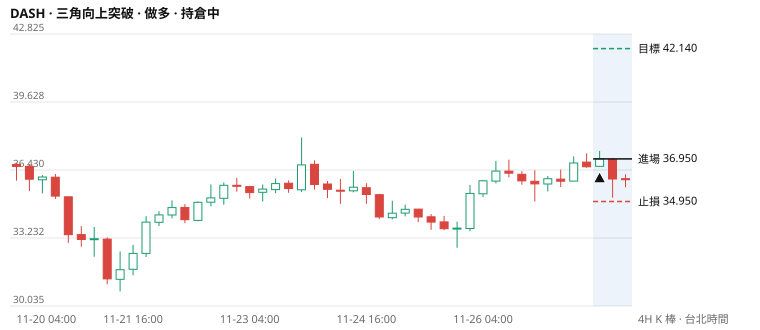

### DASH · 三角向上突破｜四段 · 做多 · 浮動 -0.56R

4H 週期｜進場 11-27 20:00 @ 36.950｜現價 35.830｜目前止損 34.950｜目標 1R、2R、3R 各出 25%（已出 0 段）

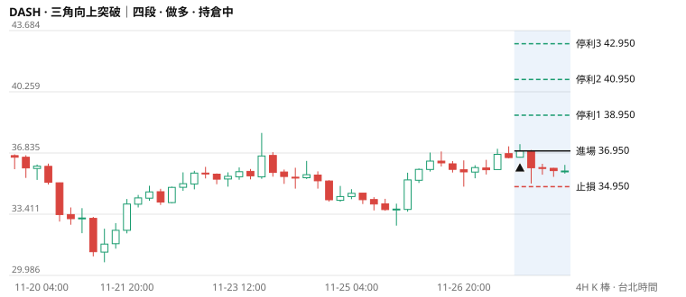

### DASH · 多頭旗形 · 做多 · 浮動 -0.56R

4H 週期｜進場 11-27 20:00 @ 36.950｜現價 35.830｜目前止損 34.950｜目標 41.100

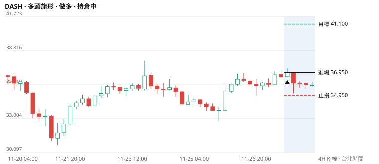

### DASH · 多頭旗形｜四段 · 做多 · 浮動 -0.56R

4H 週期｜進場 11-27 20:00 @ 36.950｜現價 35.830｜目前止損 34.950｜目標 1R、2R、3R 各出 25%（已出 0 段）

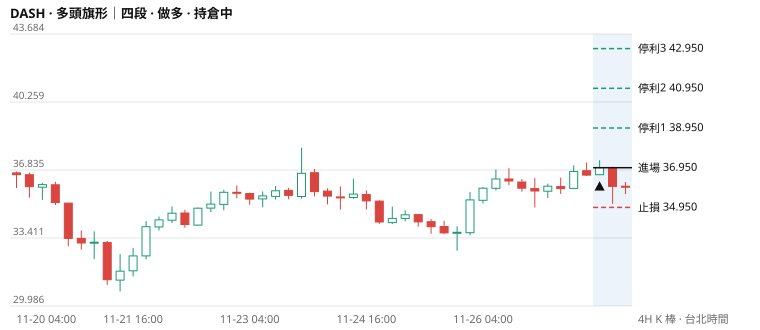

### ETH · 上升楔形 · 做空 · 浮動 -0.04R

4H 週期｜進場 11-28 08:00 @ 1,662.5｜現價 1,666.0｜目前止損 1,755.2｜目標 1,541.3

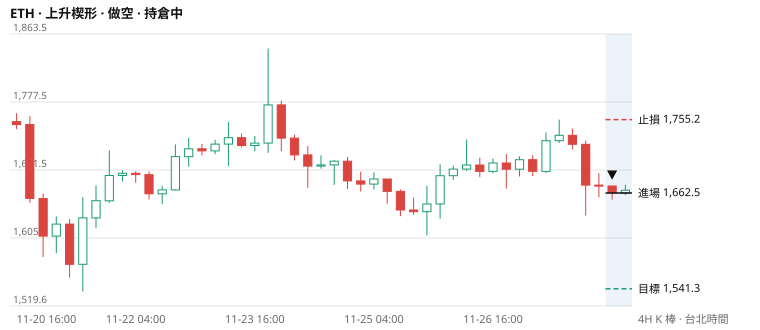

### ETH · 上升楔形｜四段 · 做空 · 浮動 -0.04R

4H 週期｜進場 11-28 08:00 @ 1,662.5｜現價 1,666.0｜目前止損 1,755.2｜目標 1R、2R、3R 各出 25%（已出 0 段）

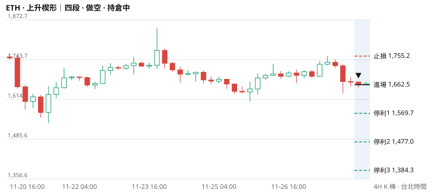

### FET · W底 · 做多 · 浮動 +0.21R

4H 週期｜進場 11-27 04:00 @ 0.1209｜現價 0.1251｜目前止損 0.1005｜目標 0.14

### FET · W底｜四段 · 做多 · 浮動 +0.21R

4H 週期｜進場 11-27 04:00 @ 0.1209｜現價 0.1251｜目前止損 0.1005｜目標 1R、2R、3R 各出 25%（已出 0 段）

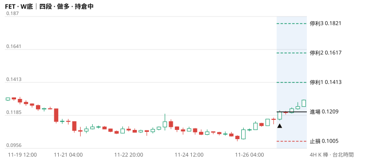

### FET · 三重底 · 做多 · 浮動 +0.21R

4H 週期｜進場 11-27 04:00 @ 0.1209｜現價 0.1251｜目前止損 0.1005｜目標 0.14

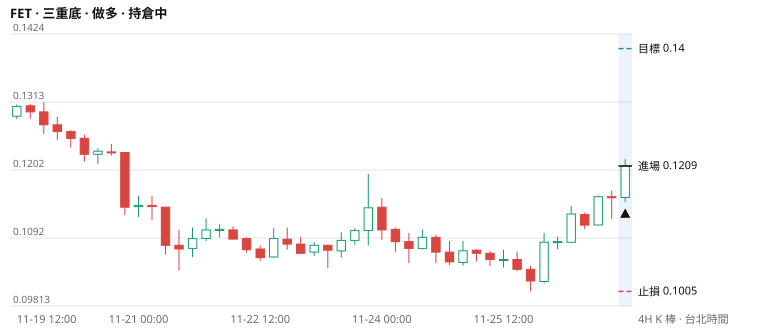

### FET · 三重底｜四段 · 做多 · 浮動 +0.21R

4H 週期｜進場 11-27 04:00 @ 0.1209｜現價 0.1251｜目前止損 0.1005｜目標 1R、2R、3R 各出 25%（已出 0 段）

### GALA · 上升三角 · 做多 · 浮動 -0.07R

4H 週期｜進場 11-28 08:00 @ 0.001434｜現價 0.00142｜目前止損 0.001229｜目標 0.001657

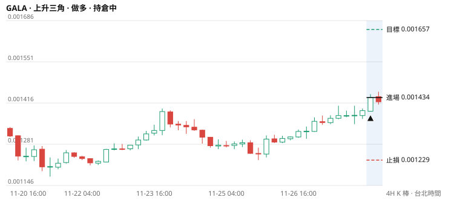

### GALA · 上升三角｜四段 · 做多 · 浮動 -0.07R

4H 週期｜進場 11-28 08:00 @ 0.001434｜現價 0.00142｜目前止損 0.001229｜目標 1R、2R、3R 各出 25%（已出 0 段）

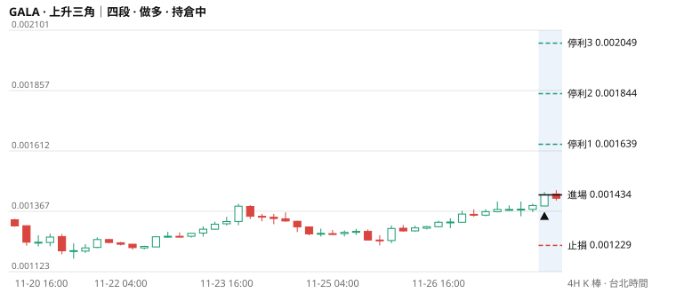

### ICP · 三角向上突破 · 做多 · 浮動 -0.40R

4H 週期｜進場 11-27 12:00 @ 2.057｜現價 2.017｜目前止損 1.957｜目標 2.308

### ICP · 三角向上突破｜四段 · 做多 · 浮動 -0.40R

4H 週期｜進場 11-27 12:00 @ 2.057｜現價 2.017｜目前止損 1.957｜目標 1R、2R、3R 各出 25%（已出 0 段）

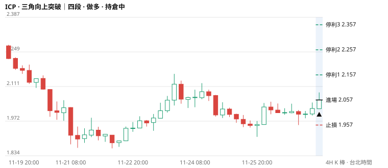

### IOTA · 三角向上突破 · 做多 · 浮動 +0.00R

4H 週期｜進場 11-27 12:00 @ 0.0327｜現價 0.0327｜目前止損 0.0312｜目標 0.0365

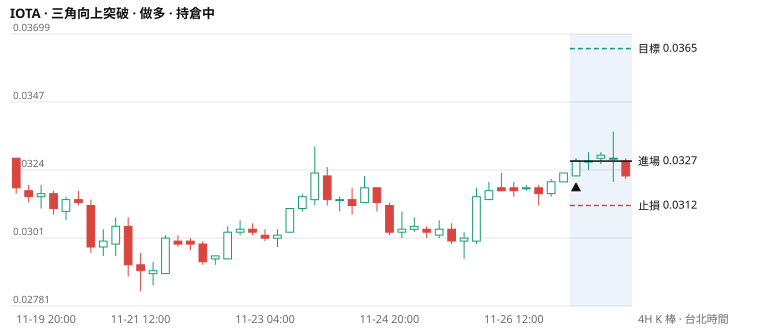

### IOTA · 三角向上突破｜四段 · 做多 · 浮動 +0.00R

4H 週期｜進場 11-27 12:00 @ 0.0327｜現價 0.0327｜目前止損 0.0312｜目標 1R、2R、3R 各出 25%（已出 0 段）

### IOTA · 多頭旗形 · 做多 · 浮動 +0.00R

4H 週期｜進場 11-27 12:00 @ 0.0327｜現價 0.0327｜目前止損 0.0312｜目標 0.0356

### IOTA · 多頭旗形｜四段 · 做多 · 浮動 +0.00R

4H 週期｜進場 11-27 12:00 @ 0.0327｜現價 0.0327｜目前止損 0.0312｜目標 1R、2R、3R 各出 25%（已出 0 段）

### KAVA · 三角向上突破｜四段 · 做多 · 浮動 +2.06R

4H 週期｜進場 11-27 04:00 @ 0.02488｜現價 0.02697｜目前止損 0.02559｜目標 1R、2R、3R 各出 25%（已出 3 段）

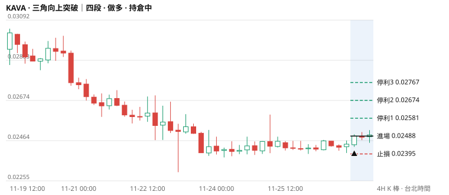

### KAVA · 三角向上突破｜四段 · 做多 · 浮動 +0.26R

4H 週期｜進場 11-27 20:00 @ 0.02636｜現價 0.02697｜目前止損 0.024｜目標 1R、2R、3R 各出 25%（已出 0 段）

### KAVA · 三角向上突破｜強勢 · 做多 · 浮動 +0.26R

4H 週期｜進場 11-27 20:00 @ 0.02636｜現價 0.02697｜目前止損 0.024｜目標 移動止損

### KAVA · 三角向上突破｜強勢四段 · 做多 · 浮動 +0.26R

4H 週期｜進場 11-27 20:00 @ 0.02636｜現價 0.02697｜目前止損 0.024｜目標 1R、2R、3R 各出 25%（已出 0 段）

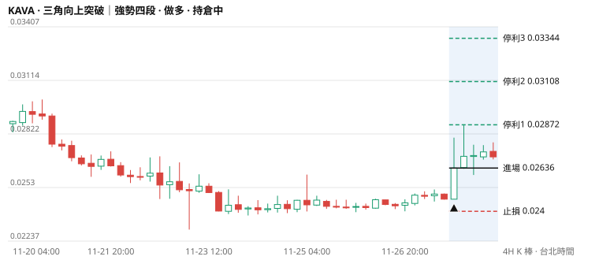

### KAVA · 三角向上突破｜強勢｜8H · 做多 · 浮動 +0.08R

8H 週期｜進場 11-28 00:00 @ 0.027｜現價 0.02724｜目前止損 0.02395｜目標 移動止損

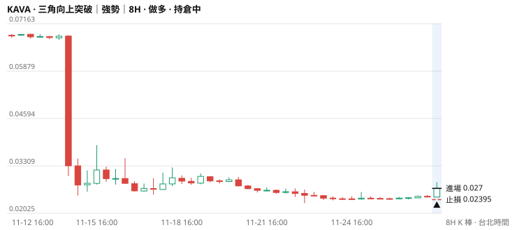

### KAVA · 三角向上突破｜強勢四段｜8H · 做多 · 浮動 +0.08R

8H 週期｜進場 11-28 00:00 @ 0.027｜現價 0.02724｜目前止損 0.02395｜目標 1R、2R、3R 各出 25%（已出 0 段）

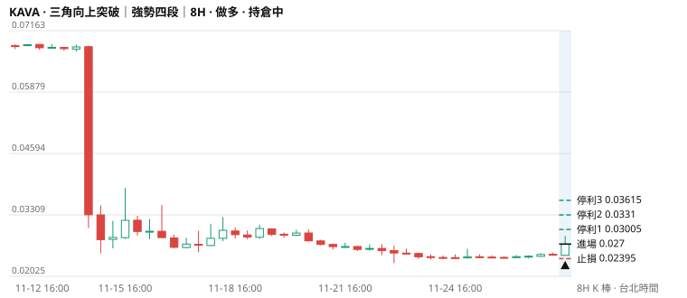

### LINK · W底 · 做多 · 浮動 -0.32R

4H 週期｜進場 11-27 16:00 @ 9.599｜現價 9.239｜目前止損 8.463｜目標 10.694

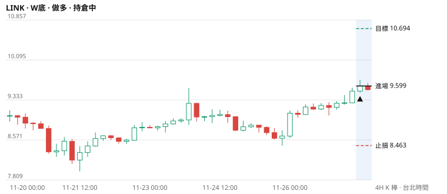

### LINK · W底｜四段 · 做多 · 浮動 -0.32R

4H 週期｜進場 11-27 16:00 @ 9.599｜現價 9.239｜目前止損 8.463｜目標 1R、2R、3R 各出 25%（已出 0 段）

### LTC · 三角向上突破 · 做多 · 浮動 +0.20R

4H 週期｜進場 11-26 12:00 @ 43.800｜現價 44.660｜目前止損 39.500｜目標 51.180

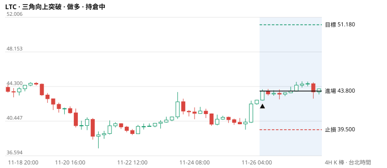

### LTC · 三角向上突破｜四段 · 做多 · 浮動 +0.20R

4H 週期｜進場 11-26 12:00 @ 43.800｜現價 44.660｜目前止損 39.500｜目標 1R、2R、3R 各出 25%（已出 0 段）

### LTC · 上升三角 · 做多 · 浮動 +0.04R

4H 週期｜進場 11-27 12:00 @ 44.460｜現價 44.660｜目前止損 39.500｜目標 50.730

### LTC · 上升三角｜四段 · 做多 · 浮動 +0.04R

4H 週期｜進場 11-27 12:00 @ 44.460｜現價 44.660｜目前止損 39.500｜目標 1R、2R、3R 各出 25%（已出 0 段）

### OP · 三角向上突破 · 做多 · 浮動 -0.24R

4H 週期｜進場 11-27 12:00 @ 0.071｜現價 0.0703｜目前止損 0.0681｜目標 0.0817

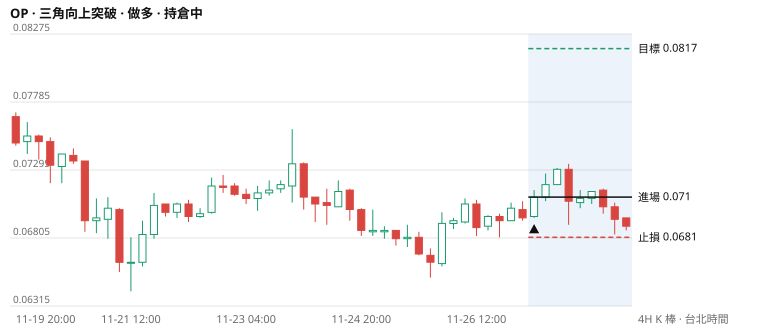

### OP · 三角向上突破｜四段 · 做多 · 浮動 -0.24R

4H 週期｜進場 11-27 12:00 @ 0.071｜現價 0.0703｜目前止損 0.0681｜目標 1R、2R、3R 各出 25%（已出 0 段）

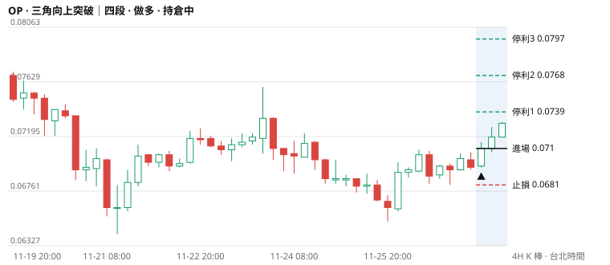

### RUNE · 頭肩底 · 做多 · 浮動 +0.38R

4H 週期｜進場 11-26 08:00 @ 0.549｜現價 0.569｜目前止損 0.496｜目標 0.6275

### RUNE · 頭肩底｜四段 · 做多 · 浮動 +0.38R

4H 週期｜進場 11-26 08:00 @ 0.549｜現價 0.569｜目前止損 0.496｜目標 1R、2R、3R 各出 25%（已出 0 段）

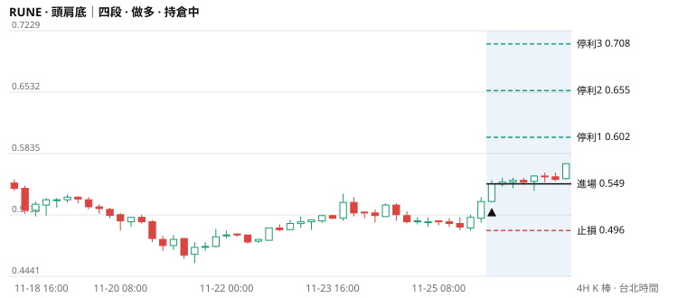

### RUNE · 上升三角 · 做多 · 浮動 +0.38R

4H 週期｜進場 11-26 08:00 @ 0.549｜現價 0.569｜目前止損 0.496｜目標 0.627

### RUNE · 上升三角｜四段 · 做多 · 浮動 +0.38R

4H 週期｜進場 11-26 08:00 @ 0.549｜現價 0.569｜目前止損 0.496｜目標 1R、2R、3R 各出 25%（已出 0 段）

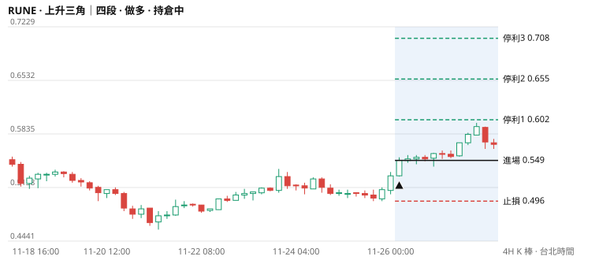

### SEI · W底｜強勢｜8H · 做多 · 浮動 -0.01R

8H 週期｜進場 11-27 00:00 @ 0.03853｜現價 0.03848｜目前止損 0.03109｜目標 移動止損

### SEI · W底｜強勢四段｜8H · 做多 · 浮動 -0.01R

8H 週期｜進場 11-27 00:00 @ 0.03853｜現價 0.03848｜目前止損 0.03109｜目標 1R、2R、3R 各出 25%（已出 0 段）

### SNX · 三角向上突破 · 做多 · 浮動 -0.60R

4H 週期｜進場 11-28 08:00 @ 0.1482｜現價 0.1437｜目前止損 0.1407｜目標 0.1771

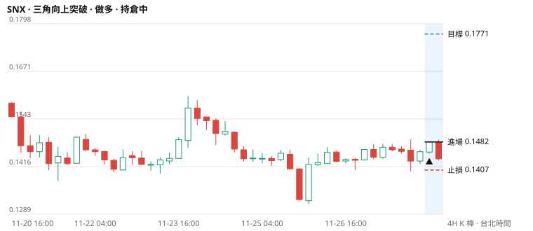

### SNX · 三角向上突破｜四段 · 做多 · 浮動 -0.60R

4H 週期｜進場 11-28 08:00 @ 0.1482｜現價 0.1437｜目前止損 0.1407｜目標 1R、2R、3R 各出 25%（已出 0 段）

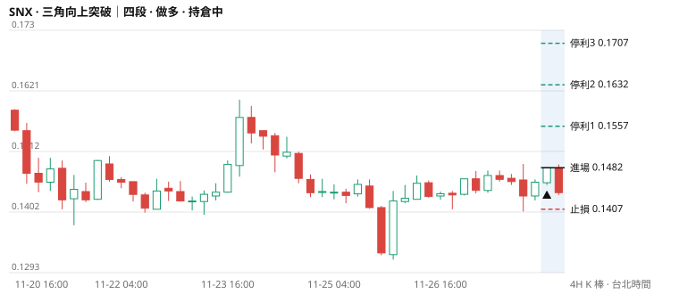

### SOL · 三角向上突破 · 做多 · 浮動 -0.34R

4H 週期｜進場 11-27 12:00 @ 72.750｜現價 71.720｜目前止損 69.710｜目標 85.390

### SOL · 三角向上突破｜四段 · 做多 · 浮動 -0.34R

4H 週期｜進場 11-27 12:00 @ 72.750｜現價 71.720｜目前止損 69.710｜目標 1R、2R、3R 各出 25%（已出 0 段）

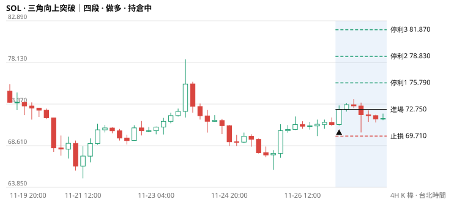

### SUI · 三角向上突破 · 做多 · 浮動 -0.44R

4H 週期｜進場 11-27 20:00 @ 0.6892｜現價 0.6716｜目前止損 0.6496｜目標 0.8088

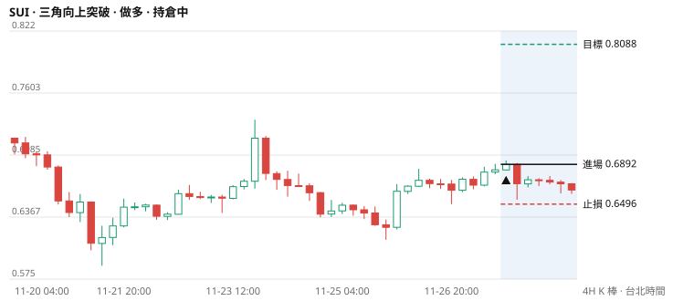

### SUI · 三角向上突破｜四段 · 做多 · 浮動 -0.44R

4H 週期｜進場 11-27 20:00 @ 0.6892｜現價 0.6716｜目前止損 0.6496｜目標 1R、2R、3R 各出 25%（已出 0 段）

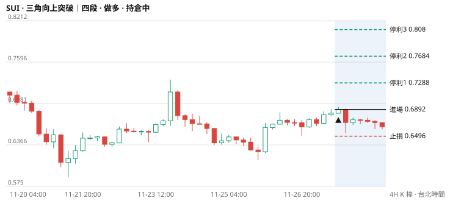

### SUI · 多頭旗形 · 做多 · 浮動 -0.44R

4H 週期｜進場 11-27 20:00 @ 0.6892｜現價 0.6716｜目前止損 0.6496｜目標 0.7599

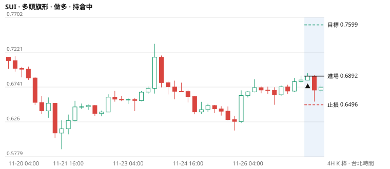

### SUI · 多頭旗形｜四段 · 做多 · 浮動 -0.44R

4H 週期｜進場 11-27 20:00 @ 0.6892｜現價 0.6716｜目前止損 0.6496｜目標 1R、2R、3R 各出 25%（已出 0 段）

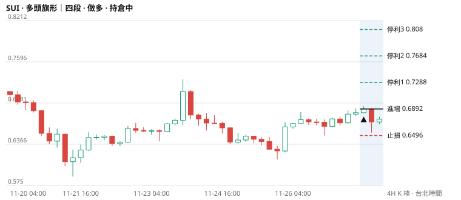

### SUSHI · 三角向下跌破 · 做空 · 浮動 -0.02R

4H 週期｜進場 11-28 00:00 @ 0.1502｜現價 0.1503｜目前止損 0.1563｜目標 0.1377

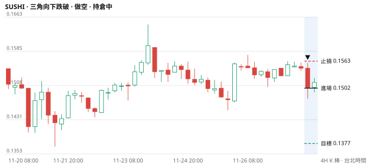

### SUSHI · 三角向下跌破｜四段 · 做空 · 浮動 -0.02R

4H 週期｜進場 11-28 00:00 @ 0.1502｜現價 0.1503｜目前止損 0.1563｜目標 1R、2R、3R 各出 25%（已出 0 段）

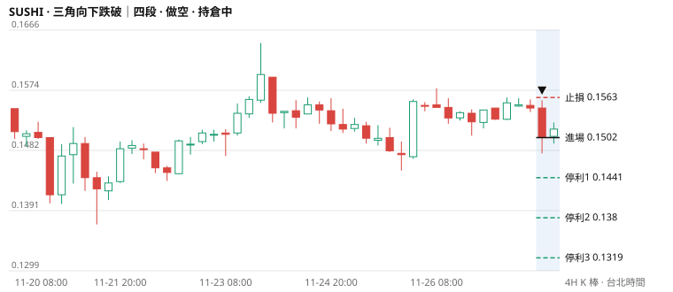

### SUSHI · 三角向下跌破｜強勢 · 做空 · 浮動 -0.02R

4H 週期｜進場 11-28 00:00 @ 0.1502｜現價 0.1503｜目前止損 0.1563｜目標 移動止損

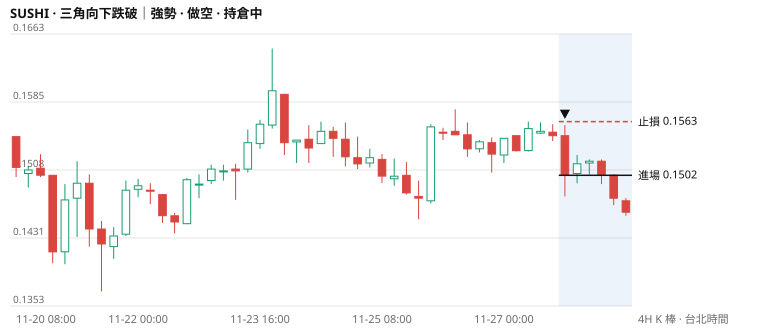

### SUSHI · 三角向下跌破｜強勢四段 · 做空 · 浮動 -0.02R

4H 週期｜進場 11-28 00:00 @ 0.1502｜現價 0.1503｜目前止損 0.1563｜目標 1R、2R、3R 各出 25%（已出 0 段）

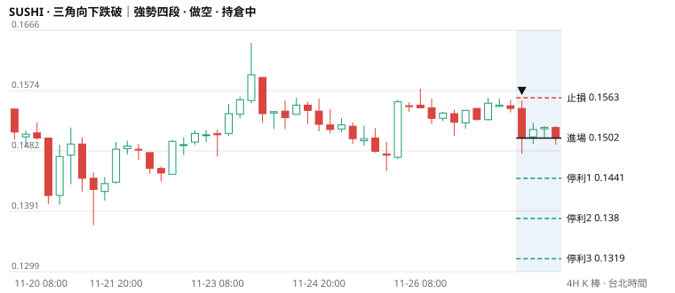

### UNI · 三角向上突破 · 做多 · 浮動 -0.34R

4H 週期｜進場 11-27 16:00 @ 4.885｜現價 4.767｜目前止損 4.541｜目標 5.832

### UNI · 三角向上突破｜四段 · 做多 · 浮動 -0.34R

4H 週期｜進場 11-27 16:00 @ 4.885｜現價 4.767｜目前止損 4.541｜目標 1R、2R、3R 各出 25%（已出 0 段）

### VET · 三角向上突破 · 做多 · 浮動 +0.11R

4H 週期｜進場 11-27 12:00 @ 0.004953｜現價 0.004994｜目前止損 0.004592｜目標 0.005449

### VET · 三角向上突破｜四段 · 做多 · 浮動 +0.11R

4H 週期｜進場 11-27 12:00 @ 0.004953｜現價 0.004994｜目前止損 0.004592｜目標 1R、2R、3R 各出 25%（已出 0 段）

### XTZ · 頭肩底 · 做多 · 浮動 +0.43R

4H 週期｜進場 11-27 04:00 @ 0.2204｜現價 0.2273｜目前止損 0.2042｜目標 0.2487

### XTZ · 頭肩底｜四段 · 做多 · 浮動 +0.43R

4H 週期｜進場 11-27 04:00 @ 0.2204｜現價 0.2273｜目前止損 0.2042｜目標 1R、2R、3R 各出 25%（已出 0 段）

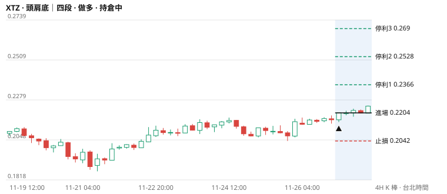

### ZIL · W底 · 做多 · 浮動 +0.02R

4H 週期｜進場 11-27 16:00 @ 0.000884｜現價 0.000886｜目前止損 0.000796｜目標 0.000966

### ZIL · W底｜四段 · 做多 · 浮動 +0.02R

4H 週期｜進場 11-27 16:00 @ 0.000884｜現價 0.000886｜目前止損 0.000796｜目標 1R、2R、3R 各出 25%（已出 0 段）

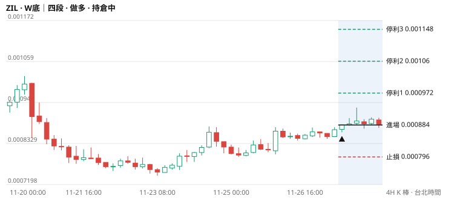

### ZIL · 箱型向上突破 · 做多 · 浮動 +0.03R

4H 週期｜進場 11-27 16:00 @ 0.000884｜現價 0.000886｜目前止損 0.000803｜目標 0.000968

### ZIL · 箱型向上突破｜四段 · 做多 · 浮動 +0.03R

4H 週期｜進場 11-27 16:00 @ 0.000884｜現價 0.000886｜目前止損 0.000803｜目標 1R、2R、3R 各出 25%（已出 0 段）

### ZRX · 上升三角 · 做多 · 浮動 -0.27R

4H 週期｜進場 11-28 08:00 @ 0.0813｜現價 0.0805｜目前止損 0.0783｜目標 0.0886

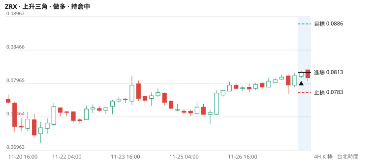

### ZRX · 上升三角｜四段 · 做多 · 浮動 -0.27R

4H 週期｜進場 11-28 08:00 @ 0.0813｜現價 0.0805｜目前止損 0.0783｜目標 1R、2R、3R 各出 25%（已出 0 段）

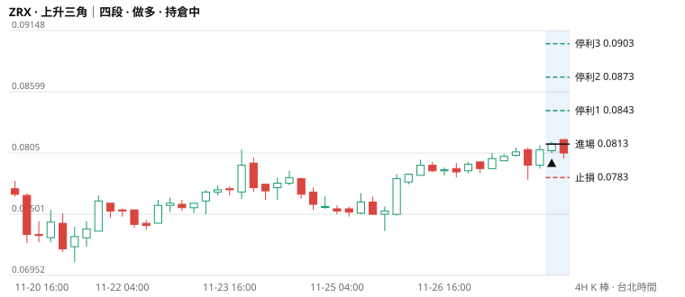

## 規則與週期比較（已結束交易）

「強勢版」和「強勢四段停利」做的是同一批進場，只有出場不同：前者全部部位用移動止損；後者在 1R、2R、3R 各出 25%，第一次停利後止損移到進場價，最後 25% 用移動止損。「原規則」和「原規則四段停利」也是同一批進場（每一個形態突破），前者目標是形態等幅，後者用同樣的四段出場。

| 組別 | 筆數 | 勝率 | 每筆平均 | 合計 |
|---|---|---|---|---|
| 4H 原規則（等幅目標） | 26 | 7.7% | -0.80R | -20.7R |
| 4H 原規則四段停利 | 24 | 0.0% | -1.03R | -24.8R |
| 4H 強勢版（移動止損） | 2 | 0.0% | -1.03R | -2.1R |
| 8H 強勢版（移動止損） | 0 | — | — | — |
| 12H 強勢版（移動止損） | 0 | — | — | — |
| 日線 強勢版（移動止損） | 0 | — | — | — |
| 4H 強勢四段停利 | 2 | 0.0% | -1.03R | -2.1R |
| 8H 強勢四段停利 | 0 | — | — | — |
| 12H 強勢四段停利 | 0 | — | — | — |
| 日線 強勢四段停利 | 0 | — | — | — |
| 全部 強勢版（移動止損） | 2 | 0.0% | -1.03R | -2.1R |
| 全部 強勢四段停利 | 2 | 0.0% | -1.03R | -2.1R |

## 最近 20 筆已結束交易

| 出場時間 | 商品 | 帳戶 | 方向 | 結果 | 出場原因 |
|---|---|---|---|---|---|
| 11-28 12:00 | STX | 上升楔形 | 做空 | -1.02R | 止損 |
| 11-28 12:00 | STX | 上升楔形｜四段 | 做空 | -1.02R | 止損 |
| 11-28 12:00 | STX | 上升楔形｜強勢 | 做空 | -1.02R | 止損 |
| 11-28 12:00 | STX | 上升楔形｜強勢四段 | 做空 | -1.02R | 止損 |
| 11-28 00:00 | BCH | 三角向上突破 | 做多 | -1.02R | 止損 |
| 11-28 00:00 | BCH | 三角向上突破｜四段 | 做多 | -1.02R | 止損 |
| 11-28 00:00 | BCH | 上升三角 | 做多 | -1.02R | 止損 |
| 11-28 00:00 | BCH | 上升三角｜四段 | 做多 | -1.02R | 止損 |
| 11-28 00:00 | BNB | 三角向上突破 | 做多 | -1.04R | 止損 |
| 11-28 00:00 | BNB | 三角向上突破｜四段 | 做多 | -1.04R | 止損 |
| 11-28 00:00 | BTC | 三角向上突破 | 做多 | -1.04R | 止損 |
| 11-28 00:00 | BTC | 三角向上突破｜四段 | 做多 | -1.04R | 止損 |
| 11-28 00:00 | CHZ | 三角向上突破 | 做多 | -1.05R | 止損 |
| 11-28 00:00 | CHZ | 三角向上突破｜四段 | 做多 | -1.05R | 止損 |
| 11-28 00:00 | ETH | 三角向上突破 | 做多 | -1.03R | 止損 |
| 11-28 00:00 | ETH | 三角向上突破｜四段 | 做多 | -1.03R | 止損 |
| 11-28 00:00 | GRT | 三角向上突破 | 做多 | -1.03R | 止損 |
| 11-28 00:00 | GRT | 三角向上突破｜四段 | 做多 | -1.03R | 止損 |
| 11-28 00:00 | IMX | 上升三角 | 做多 | -1.04R | 止損 |
| 11-28 00:00 | IMX | 上升三角｜四段 | 做多 | -1.04R | 止損 |

## 最近 10 筆已結束交易的圖表

黑色三角是進場，藍色三角是出場。**每一筆已結束交易的圖表都在 [TRADES.md](TRADES.md)**，依月份分頁。

### STX · 上升楔形 · 做空 · -1.02R

4H 週期｜進場 11-28 00:00 @ 0.2531｜止損 0.2681｜目標 0.2342｜出場 11-28 12:00 @ 0.2681（止損）

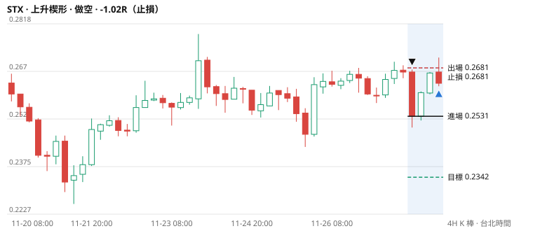

### STX · 上升楔形｜四段 · 做空 · -1.02R

4H 週期｜進場 11-28 00:00 @ 0.2531｜止損 0.2681｜目標 1R、2R、3R 各出 25%｜出場 11-28 12:00 @ 0.2681（止損）

### STX · 上升楔形｜強勢 · 做空 · -1.02R

4H 週期｜進場 11-28 00:00 @ 0.2531｜止損 0.2681｜目標 移動止損｜出場 11-28 12:00 @ 0.2681（止損）

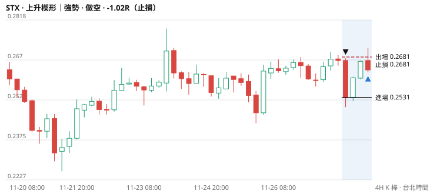

### STX · 上升楔形｜強勢四段 · 做空 · -1.02R

4H 週期｜進場 11-28 00:00 @ 0.2531｜止損 0.2681｜目標 1R、2R、3R 各出 25%｜出場 11-28 12:00 @ 0.2681（止損）

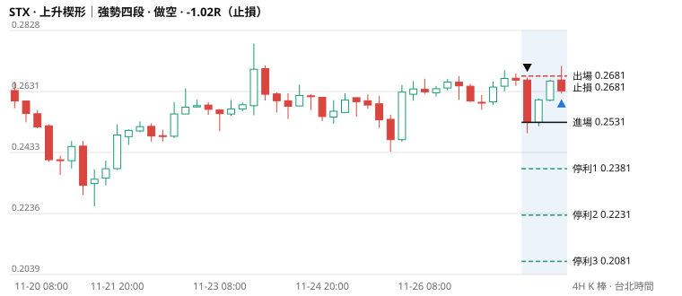

### BCH · 三角向上突破 · 做多 · -1.02R

4H 週期｜進場 11-27 12:00 @ 216.400｜止損 204.200｜目標 238.800｜出場 11-28 00:00 @ 204.200（止損）

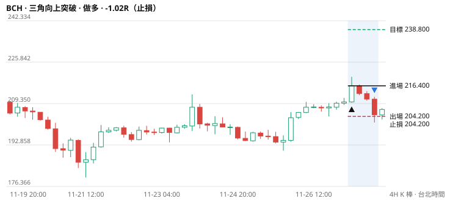

### BCH · 三角向上突破｜四段 · 做多 · -1.02R

4H 週期｜進場 11-27 12:00 @ 216.400｜止損 204.200｜目標 1R、2R、3R 各出 25%｜出場 11-28 00:00 @ 204.200（止損）

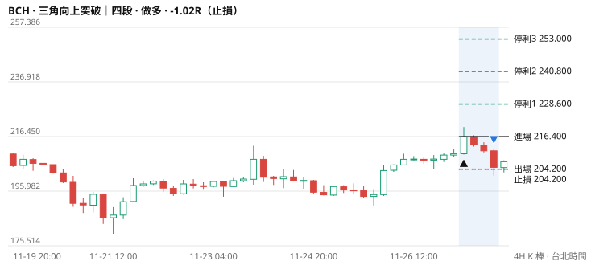

### BCH · 上升三角 · 做多 · -1.02R

4H 週期｜進場 11-27 12:00 @ 216.400｜止損 204.200｜目標 238.800｜出場 11-28 00:00 @ 204.200（止損）

### BCH · 上升三角｜四段 · 做多 · -1.02R

4H 週期｜進場 11-27 12:00 @ 216.400｜止損 204.200｜目標 1R、2R、3R 各出 25%｜出場 11-28 00:00 @ 204.200（止損）

### BNB · 三角向上突破 · 做多 · -1.04R

4H 週期｜進場 11-27 16:00 @ 565.090｜止損 544.610｜目標 625.730｜出場 11-28 00:00 @ 544.610（止損）

### BNB · 三角向上突破｜四段 · 做多 · -1.04R

4H 週期｜進場 11-27 16:00 @ 565.090｜止損 544.610｜目標 1R、2R、3R 各出 25%｜出場 11-28 00:00 @ 544.610（止損）

## 各帳戶損益（只列有交易的）

| 帳戶 | 損益 USDT |
|---|---|
| 頭肩頂｜四段 | -51 |
| 頭肩頂 | -51 |
| 三角向下跌破｜四段 | -51 |
| 三角向下跌破 | -51 |
| 上升楔形｜強勢四段 | -51 |
| 上升楔形｜強勢 | -51 |
| 三角向上突破｜強勢四段 | -52 |
| 三角向上突破｜強勢 | -52 |
| 上升楔形 | -101 |
| 上升楔形｜四段 | -101 |
| 下降三角 | -101 |
| 下降三角｜四段 | -101 |
| 上升三角｜四段 | -103 |
| 上升三角 | -103 |
| 多頭旗形｜四段 | -156 |
| 多頭旗形 | -156 |
| 三角向上突破 | -463 |
| 三角向上突破｜四段 | -654 |

完整互動圖表：https://ashin047.github.io/pattern-paper-bot/
