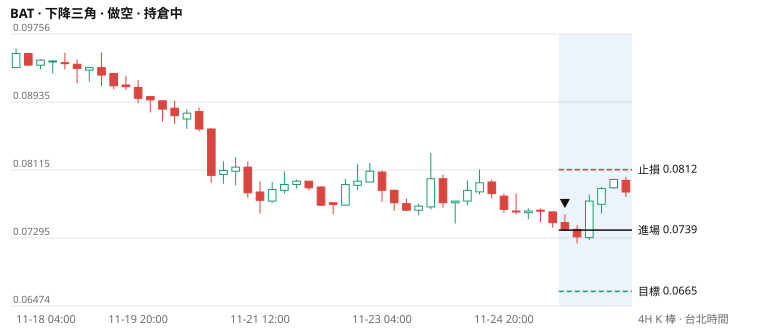
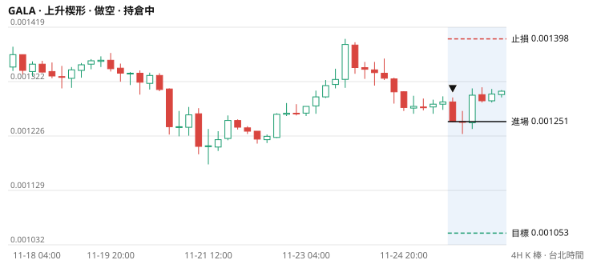
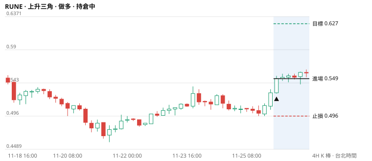

# 形態模擬交易狀態

更新時間：11-26 17:15（台北時間）。每 4 小時自動更新一次。

全部是模擬資金，沒有真實下單，也不是投資建議。

完整互動圖表（可切換週期、篩選、看回測）：https://ashin047.github.io/pattern-paper-bot/

## 總覽

| 項目 | 數值 |
|---|---|
| 開始實測 | 11-25 16:05 |
| 已結束交易 | 3 筆 |
| 勝率 | 0.0% |
| 每筆平均 | -1.02R |
| 合計 | -3.1R |
| 持倉中 | 8 筆，5 個商品 |
| 持倉浮動損益合計 | -1.2R |
| 有交易的帳戶 | 3 / 80 |
| 全部帳戶合計損益 | -153 USDT |

## 持倉中

| 商品 | 帳戶 | 方向 | 進場時間 | 進場價 | 現價 | 目前止損 | 目標 | 浮動損益 |
|---|---|---|---|---|---|---|---|---|
| BAT | M頭 | 做空 | 11-25 20:00 | 0.0739 | 0.0785 | 0.0832 | 0.0654 | -0.49R |
| BAT | 下降三角 | 做空 | 11-25 20:00 | 0.0739 | 0.0785 | 0.0812 | 0.0665 | -0.63R |
| GALA | 上升楔形 | 做空 | 11-25 20:00 | 0.001251 | 0.001305 | 0.001398 | 0.001053 | -0.37R |
| LTC | 三角向上突破 | 做多 | 11-26 12:00 | 43.800 | 43.470 | 39.500 | 51.180 | -0.08R |
| RUNE | 頭肩底 | 做多 | 11-26 08:00 | 0.549 | 0.553 | 0.496 | 0.6275 | +0.07R |
| RUNE | 上升三角 | 做多 | 11-26 08:00 | 0.549 | 0.553 | 0.496 | 0.627 | +0.07R |
| STX | 三角向上突破 | 做多 | 11-26 04:00 | 0.2629 | 0.264 | 0.2527 | 0.2913 | +0.11R |
| STX | 三角向上突破｜強勢 | 做多 | 11-26 04:00 | 0.2629 | 0.264 | 0.2527 | 移動止損 | +0.11R |

## 持倉圖表

每筆持倉一張圖，用它自己的進場週期畫。黑色三角是進場的 K 棒，藍色底是持倉期間。

### BAT · M頭 · 做空 · 浮動 -0.49R

4H 週期｜進場 11-25 20:00 @ 0.0739｜現價 0.0785｜目前止損 0.0832｜目標 0.0654

### BAT · 下降三角 · 做空 · 浮動 -0.63R

4H 週期｜進場 11-25 20:00 @ 0.0739｜現價 0.0785｜目前止損 0.0812｜目標 0.0665

### GALA · 上升楔形 · 做空 · 浮動 -0.37R

4H 週期｜進場 11-25 20:00 @ 0.001251｜現價 0.001305｜目前止損 0.001398｜目標 0.001053

### LTC · 三角向上突破 · 做多 · 浮動 -0.08R

4H 週期｜進場 11-26 12:00 @ 43.800｜現價 43.470｜目前止損 39.500｜目標 51.180

### RUNE · 頭肩底 · 做多 · 浮動 +0.07R

4H 週期｜進場 11-26 08:00 @ 0.549｜現價 0.553｜目前止損 0.496｜目標 0.6275

### RUNE · 上升三角 · 做多 · 浮動 +0.07R

4H 週期｜進場 11-26 08:00 @ 0.549｜現價 0.553｜目前止損 0.496｜目標 0.627

### STX · 三角向上突破 · 做多 · 浮動 +0.11R

4H 週期｜進場 11-26 04:00 @ 0.2629｜現價 0.264｜目前止損 0.2527｜目標 0.2913

### STX · 三角向上突破｜強勢 · 做多 · 浮動 +0.11R

4H 週期｜進場 11-26 04:00 @ 0.2629｜現價 0.264｜目前止損 0.2527｜目標 移動止損

## 規則與週期比較（已結束交易）

| 組別 | 筆數 | 勝率 | 每筆平均 | 合計 |
|---|---|---|---|---|
| 4H 原規則 | 3 | 0.0% | -1.02R | -3.1R |
| 4H 強勢版 | 0 | — | — | — |
| 8H 強勢版 | 0 | — | — | — |
| 12H 強勢版 | 0 | — | — | — |
| 日線 強勢版 | 0 | — | — | — |

## 最近 20 筆已結束交易

| 出場時間 | 商品 | 帳戶 | 方向 | 結果 | 出場原因 |
|---|---|---|---|---|---|
| 11-26 04:00 | STX | 頭肩頂 | 做空 | -1.02R | 止損 |
| 11-26 04:00 | STX | 三角向下跌破 | 做空 | -1.02R | 止損 |
| 11-26 04:00 | STX | 下降三角 | 做空 | -1.02R | 止損 |

## 最近 10 筆已結束交易的圖表

黑色三角是進場，藍色三角是出場。**每一筆已結束交易的圖表都在 [TRADES.md](TRADES.md)**，依月份分頁。

### STX · 頭肩頂 · 做空 · -1.02R

4H 週期｜進場 11-26 00:00 @ 0.2475｜止損 0.2625｜目標 0.2203｜出場 11-26 04:00 @ 0.2625（止損）

### STX · 三角向下跌破 · 做空 · -1.02R

4H 週期｜進場 11-26 00:00 @ 0.2475｜止損 0.2625｜目標 0.2191｜出場 11-26 04:00 @ 0.2625（止損）

### STX · 下降三角 · 做空 · -1.02R

4H 週期｜進場 11-26 00:00 @ 0.2475｜止損 0.2625｜目標 0.2191｜出場 11-26 04:00 @ 0.2625（止損）

## 各帳戶損益（只列有交易的）

| 帳戶 | 損益 USDT |
|---|---|
| 頭肩頂 | -51 |
| 下降三角 | -51 |
| 三角向下跌破 | -51 |

完整互動圖表：https://ashin047.github.io/pattern-paper-bot/
