# 形態模擬交易狀態

更新時間：11-27 05:52（台北時間）。每 4 小時自動更新一次。

全部是模擬資金，沒有真實下單，也不是投資建議。

完整互動圖表（可切換週期、篩選、看回測）：https://ashin047.github.io/pattern-paper-bot/

## 總覽

| 項目 | 數值 |
|---|---|
| 開始實測 | 11-25 16:05 |
| 已結束交易 | 8 筆 |
| 勝率 | 0.0% |
| 每筆平均 | -1.02R |
| 合計 | -8.1R |
| 持倉中 | 26 筆，10 個商品 |
| 持倉浮動損益合計 | -4.2R |
| 有交易的帳戶 | 6 / 160 |
| 全部帳戶合計損益 | -407 USDT |

## 持倉中

| 商品 | 帳戶 | 方向 | 進場時間 | 進場價 | 現價 | 目前止損 | 目標 | 浮動損益 |
|---|---|---|---|---|---|---|---|---|
| ATOM | 三角向下跌破 | 做空 | 11-27 00:00 | 1.189 | 1.220 | 1.276 | 1.016 | -0.36R |
| ATOM | 三角向下跌破｜四段 | 做空 | 11-27 00:00 | 1.189 | 1.220 | 1.276 | 1R、2R、3R 各出 25%（已出 0 段） | -0.36R |
| BAT | M頭 | 做空 | 11-25 20:00 | 0.0739 | 0.0804 | 0.0832 | 0.0654 | -0.70R |
| BAT | M頭｜四段 | 做空 | 11-25 20:00 | 0.0739 | 0.0804 | 0.0832 | 1R、2R、3R 各出 25%（已出 0 段） | -0.70R |
| FET | W底 | 做多 | 11-27 04:00 | 0.1209 | 0.1209 | 0.1005 | 0.14 | +0.00R |
| FET | W底｜四段 | 做多 | 11-27 04:00 | 0.1209 | 0.1209 | 0.1005 | 1R、2R、3R 各出 25%（已出 0 段） | +0.00R |
| FET | 三重底 | 做多 | 11-27 04:00 | 0.1209 | 0.1209 | 0.1005 | 0.14 | +0.00R |
| FET | 三重底｜四段 | 做多 | 11-27 04:00 | 0.1209 | 0.1209 | 0.1005 | 1R、2R、3R 各出 25%（已出 0 段） | +0.00R |
| GALA | 上升楔形 | 做空 | 11-25 20:00 | 0.001251 | 0.001356 | 0.001398 | 0.001053 | -0.71R |
| GALA | 上升楔形｜四段 | 做空 | 11-25 20:00 | 0.001251 | 0.001356 | 0.001398 | 1R、2R、3R 各出 25%（已出 0 段） | -0.71R |
| KAVA | 三角向上突破 | 做多 | 11-27 04:00 | 0.02488 | 0.02488 | 0.02395 | 0.02788 | +0.00R |
| KAVA | 三角向上突破｜四段 | 做多 | 11-27 04:00 | 0.02488 | 0.02488 | 0.02395 | 1R、2R、3R 各出 25%（已出 0 段） | +0.00R |
| LTC | 三角向上突破 | 做多 | 11-26 12:00 | 43.800 | 43.610 | 39.500 | 51.180 | -0.04R |
| LTC | 三角向上突破｜四段 | 做多 | 11-26 12:00 | 43.800 | 43.610 | 39.500 | 1R、2R、3R 各出 25%（已出 0 段） | -0.04R |
| RUNE | 頭肩底 | 做多 | 11-26 08:00 | 0.549 | 0.557 | 0.496 | 0.6275 | +0.15R |
| RUNE | 頭肩底｜四段 | 做多 | 11-26 08:00 | 0.549 | 0.557 | 0.496 | 1R、2R、3R 各出 25%（已出 0 段） | +0.15R |
| RUNE | 上升三角 | 做多 | 11-26 08:00 | 0.549 | 0.557 | 0.496 | 0.627 | +0.15R |
| RUNE | 上升三角｜四段 | 做多 | 11-26 08:00 | 0.549 | 0.557 | 0.496 | 1R、2R、3R 各出 25%（已出 0 段） | +0.15R |
| SEI | W底｜強勢｜8H | 做多 | 11-27 00:00 | 0.03853 | 0.03853 | 0.03109 | 移動止損 | +0.00R |
| SEI | W底｜強勢四段｜8H | 做多 | 11-27 00:00 | 0.03853 | 0.03853 | 0.03109 | 1R、2R、3R 各出 25%（已出 0 段） | +0.00R |
| STX | 三角向上突破 | 做多 | 11-26 04:00 | 0.2629 | 0.26 | 0.2527 | 0.2913 | -0.28R |
| STX | 三角向上突破｜四段 | 做多 | 11-26 04:00 | 0.2629 | 0.26 | 0.2527 | 1R、2R、3R 各出 25%（已出 0 段） | -0.28R |
| STX | 三角向上突破｜強勢 | 做多 | 11-26 04:00 | 0.2629 | 0.26 | 0.2527 | 移動止損 | -0.28R |
| STX | 三角向上突破｜強勢四段 | 做多 | 11-26 04:00 | 0.2629 | 0.26 | 0.2527 | 1R、2R、3R 各出 25%（已出 0 段） | -0.28R |
| XTZ | 頭肩底 | 做多 | 11-27 04:00 | 0.2204 | 0.2204 | 0.2042 | 0.2487 | +0.00R |
| XTZ | 頭肩底｜四段 | 做多 | 11-27 04:00 | 0.2204 | 0.2204 | 0.2042 | 1R、2R、3R 各出 25%（已出 0 段） | +0.00R |

## 持倉圖表

每筆持倉一張圖，用它自己的進場週期畫。黑色三角是進場的 K 棒，藍色底是持倉期間。

### ATOM · 三角向下跌破 · 做空 · 浮動 -0.36R

4H 週期｜進場 11-27 00:00 @ 1.189｜現價 1.220｜目前止損 1.276｜目標 1.016

### ATOM · 三角向下跌破｜四段 · 做空 · 浮動 -0.36R

4H 週期｜進場 11-27 00:00 @ 1.189｜現價 1.220｜目前止損 1.276｜目標 1R、2R、3R 各出 25%（已出 0 段）

### BAT · M頭 · 做空 · 浮動 -0.70R

4H 週期｜進場 11-25 20:00 @ 0.0739｜現價 0.0804｜目前止損 0.0832｜目標 0.0654

### BAT · M頭｜四段 · 做空 · 浮動 -0.70R

4H 週期｜進場 11-25 20:00 @ 0.0739｜現價 0.0804｜目前止損 0.0832｜目標 1R、2R、3R 各出 25%（已出 0 段）

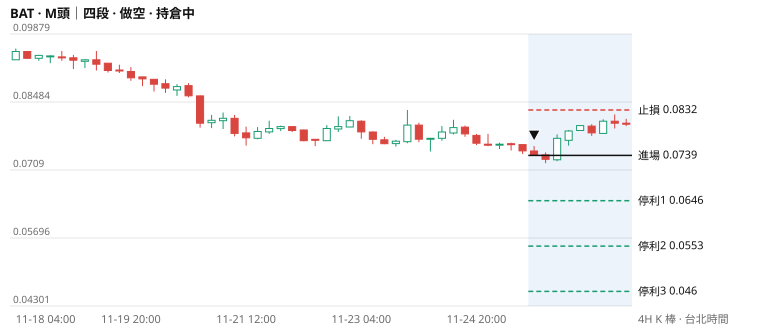

### FET · W底 · 做多 · 浮動 +0.00R

4H 週期｜進場 11-27 04:00 @ 0.1209｜現價 0.1209｜目前止損 0.1005｜目標 0.14

### FET · W底｜四段 · 做多 · 浮動 +0.00R

4H 週期｜進場 11-27 04:00 @ 0.1209｜現價 0.1209｜目前止損 0.1005｜目標 1R、2R、3R 各出 25%（已出 0 段）

### FET · 三重底 · 做多 · 浮動 +0.00R

4H 週期｜進場 11-27 04:00 @ 0.1209｜現價 0.1209｜目前止損 0.1005｜目標 0.14

### FET · 三重底｜四段 · 做多 · 浮動 +0.00R

4H 週期｜進場 11-27 04:00 @ 0.1209｜現價 0.1209｜目前止損 0.1005｜目標 1R、2R、3R 各出 25%（已出 0 段）

### GALA · 上升楔形 · 做空 · 浮動 -0.71R

4H 週期｜進場 11-25 20:00 @ 0.001251｜現價 0.001356｜目前止損 0.001398｜目標 0.001053

### GALA · 上升楔形｜四段 · 做空 · 浮動 -0.71R

4H 週期｜進場 11-25 20:00 @ 0.001251｜現價 0.001356｜目前止損 0.001398｜目標 1R、2R、3R 各出 25%（已出 0 段）

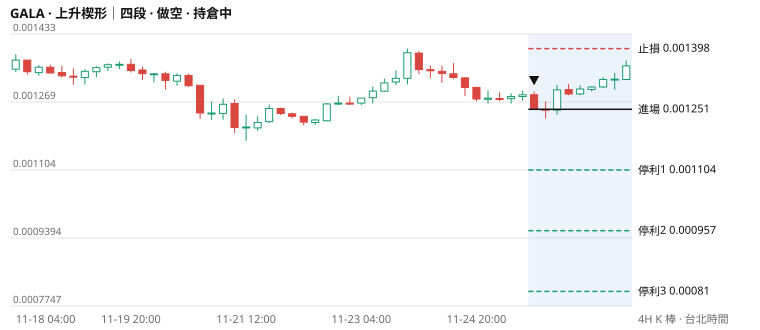

### KAVA · 三角向上突破 · 做多 · 浮動 +0.00R

4H 週期｜進場 11-27 04:00 @ 0.02488｜現價 0.02488｜目前止損 0.02395｜目標 0.02788

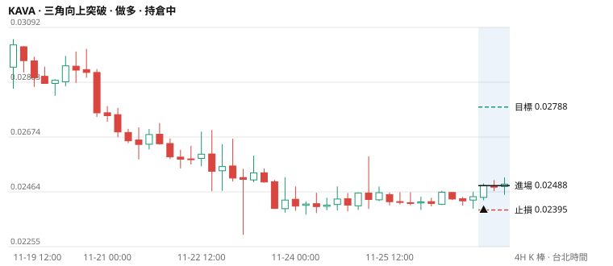

### KAVA · 三角向上突破｜四段 · 做多 · 浮動 +0.00R

4H 週期｜進場 11-27 04:00 @ 0.02488｜現價 0.02488｜目前止損 0.02395｜目標 1R、2R、3R 各出 25%（已出 0 段）

### LTC · 三角向上突破 · 做多 · 浮動 -0.04R

4H 週期｜進場 11-26 12:00 @ 43.800｜現價 43.610｜目前止損 39.500｜目標 51.180

### LTC · 三角向上突破｜四段 · 做多 · 浮動 -0.04R

4H 週期｜進場 11-26 12:00 @ 43.800｜現價 43.610｜目前止損 39.500｜目標 1R、2R、3R 各出 25%（已出 0 段）

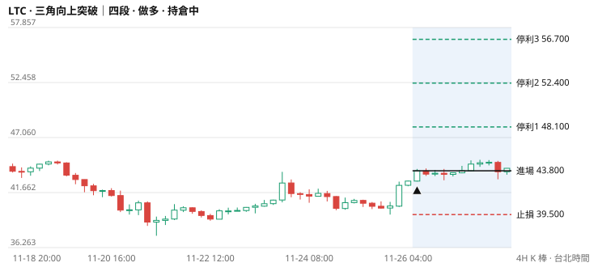

### RUNE · 頭肩底 · 做多 · 浮動 +0.15R

4H 週期｜進場 11-26 08:00 @ 0.549｜現價 0.557｜目前止損 0.496｜目標 0.6275

### RUNE · 頭肩底｜四段 · 做多 · 浮動 +0.15R

4H 週期｜進場 11-26 08:00 @ 0.549｜現價 0.557｜目前止損 0.496｜目標 1R、2R、3R 各出 25%（已出 0 段）

### RUNE · 上升三角 · 做多 · 浮動 +0.15R

4H 週期｜進場 11-26 08:00 @ 0.549｜現價 0.557｜目前止損 0.496｜目標 0.627

### RUNE · 上升三角｜四段 · 做多 · 浮動 +0.15R

4H 週期｜進場 11-26 08:00 @ 0.549｜現價 0.557｜目前止損 0.496｜目標 1R、2R、3R 各出 25%（已出 0 段）

### SEI · W底｜強勢｜8H · 做多 · 浮動 +0.00R

8H 週期｜進場 11-27 00:00 @ 0.03853｜現價 0.03853｜目前止損 0.03109｜目標 移動止損

### SEI · W底｜強勢四段｜8H · 做多 · 浮動 +0.00R

8H 週期｜進場 11-27 00:00 @ 0.03853｜現價 0.03853｜目前止損 0.03109｜目標 1R、2R、3R 各出 25%（已出 0 段）

### STX · 三角向上突破 · 做多 · 浮動 -0.28R

4H 週期｜進場 11-26 04:00 @ 0.2629｜現價 0.26｜目前止損 0.2527｜目標 0.2913

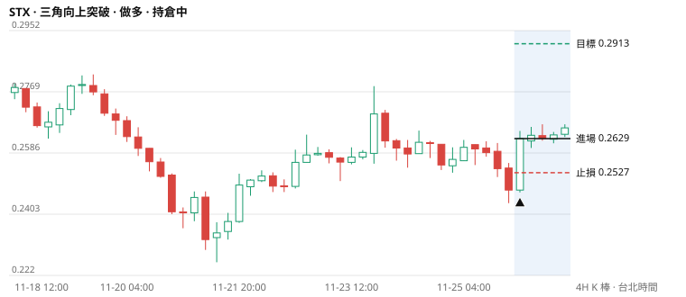

### STX · 三角向上突破｜四段 · 做多 · 浮動 -0.28R

4H 週期｜進場 11-26 04:00 @ 0.2629｜現價 0.26｜目前止損 0.2527｜目標 1R、2R、3R 各出 25%（已出 0 段）

### STX · 三角向上突破｜強勢 · 做多 · 浮動 -0.28R

4H 週期｜進場 11-26 04:00 @ 0.2629｜現價 0.26｜目前止損 0.2527｜目標 移動止損

### STX · 三角向上突破｜強勢四段 · 做多 · 浮動 -0.28R

4H 週期｜進場 11-26 04:00 @ 0.2629｜現價 0.26｜目前止損 0.2527｜目標 1R、2R、3R 各出 25%（已出 0 段）

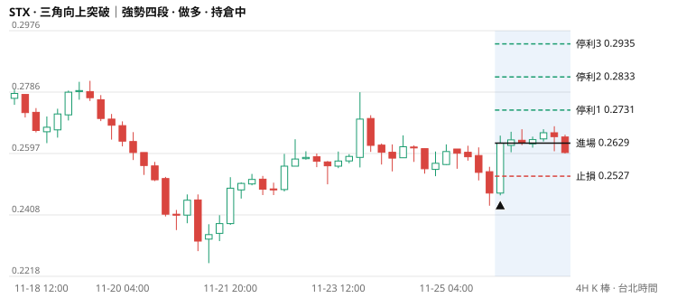

### XTZ · 頭肩底 · 做多 · 浮動 +0.00R

4H 週期｜進場 11-27 04:00 @ 0.2204｜現價 0.2204｜目前止損 0.2042｜目標 0.2487

### XTZ · 頭肩底｜四段 · 做多 · 浮動 +0.00R

4H 週期｜進場 11-27 04:00 @ 0.2204｜現價 0.2204｜目前止損 0.2042｜目標 1R、2R、3R 各出 25%（已出 0 段）

## 規則與週期比較（已結束交易）

「強勢版」和「強勢四段停利」做的是同一批進場，只有出場不同：前者全部部位用移動止損；後者在 1R、2R、3R 各出 25%，第一次停利後止損移到進場價，最後 25% 用移動止損。「原規則」和「原規則四段停利」也是同一批進場（每一個形態突破），前者目標是形態等幅，後者用同樣的四段出場。

| 組別 | 筆數 | 勝率 | 每筆平均 | 合計 |
|---|---|---|---|---|
| 4H 原規則（等幅目標） | 4 | 0.0% | -1.02R | -4.1R |
| 4H 原規則四段停利 | 4 | 0.0% | -1.02R | -4.1R |
| 4H 強勢版（移動止損） | 0 | — | — | — |
| 8H 強勢版（移動止損） | 0 | — | — | — |
| 12H 強勢版（移動止損） | 0 | — | — | — |
| 日線 強勢版（移動止損） | 0 | — | — | — |
| 4H 強勢四段停利 | 0 | — | — | — |
| 8H 強勢四段停利 | 0 | — | — | — |
| 12H 強勢四段停利 | 0 | — | — | — |
| 日線 強勢四段停利 | 0 | — | — | — |
| 全部 強勢版（移動止損） | 0 | — | — | — |
| 全部 強勢四段停利 | 0 | — | — | — |

## 最近 20 筆已結束交易

| 出場時間 | 商品 | 帳戶 | 方向 | 結果 | 出場原因 |
|---|---|---|---|---|---|
| 11-26 20:00 | BAT | 下降三角 | 做空 | -1.01R | 止損 |
| 11-26 20:00 | BAT | 下降三角｜四段 | 做空 | -1.01R | 止損 |
| 11-26 04:00 | STX | 頭肩頂 | 做空 | -1.02R | 止損 |
| 11-26 04:00 | STX | 三角向下跌破 | 做空 | -1.02R | 止損 |
| 11-26 04:00 | STX | 下降三角 | 做空 | -1.02R | 止損 |
| 11-26 04:00 | STX | 頭肩頂｜四段 | 做空 | -1.02R | 止損 |
| 11-26 04:00 | STX | 三角向下跌破｜四段 | 做空 | -1.02R | 止損 |
| 11-26 04:00 | STX | 下降三角｜四段 | 做空 | -1.02R | 止損 |

## 最近 10 筆已結束交易的圖表

黑色三角是進場，藍色三角是出場。**每一筆已結束交易的圖表都在 [TRADES.md](TRADES.md)**，依月份分頁。

### BAT · 下降三角 · 做空 · -1.01R

4H 週期｜進場 11-25 20:00 @ 0.0739｜止損 0.0812｜目標 0.0665｜出場 11-26 20:00 @ 0.0812（止損）

### BAT · 下降三角｜四段 · 做空 · -1.01R

4H 週期｜進場 11-25 20:00 @ 0.0739｜止損 0.0812｜目標 1R、2R、3R 各出 25%｜出場 11-26 20:00 @ 0.0812（止損）

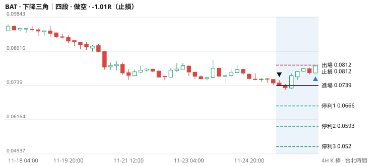

### STX · 頭肩頂 · 做空 · -1.02R

4H 週期｜進場 11-26 00:00 @ 0.2475｜止損 0.2625｜目標 0.2203｜出場 11-26 04:00 @ 0.2625（止損）

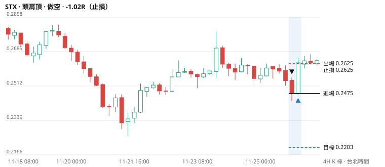

### STX · 三角向下跌破 · 做空 · -1.02R

4H 週期｜進場 11-26 00:00 @ 0.2475｜止損 0.2625｜目標 0.2191｜出場 11-26 04:00 @ 0.2625（止損）

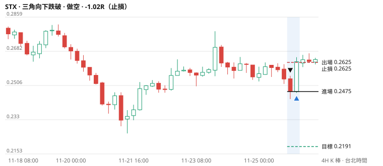

### STX · 下降三角 · 做空 · -1.02R

4H 週期｜進場 11-26 00:00 @ 0.2475｜止損 0.2625｜目標 0.2191｜出場 11-26 04:00 @ 0.2625（止損）

### STX · 頭肩頂｜四段 · 做空 · -1.02R

4H 週期｜進場 11-26 00:00 @ 0.2475｜止損 0.2625｜目標 1R、2R、3R 各出 25%｜出場 11-26 04:00 @ 0.2625（止損）

### STX · 三角向下跌破｜四段 · 做空 · -1.02R

4H 週期｜進場 11-26 00:00 @ 0.2475｜止損 0.2625｜目標 1R、2R、3R 各出 25%｜出場 11-26 04:00 @ 0.2625（止損）

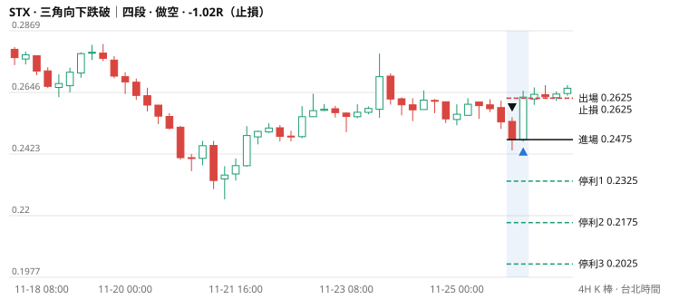

### STX · 下降三角｜四段 · 做空 · -1.02R

4H 週期｜進場 11-26 00:00 @ 0.2475｜止損 0.2625｜目標 1R、2R、3R 各出 25%｜出場 11-26 04:00 @ 0.2625（止損）

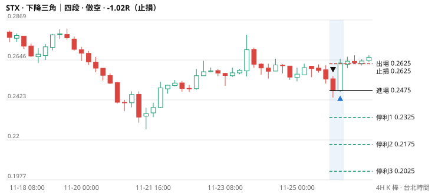

## 各帳戶損益（只列有交易的）

| 帳戶 | 損益 USDT |
|---|---|
| 頭肩頂｜四段 | -51 |
| 頭肩頂 | -51 |
| 三角向下跌破｜四段 | -51 |
| 三角向下跌破 | -51 |
| 下降三角 | -101 |
| 下降三角｜四段 | -101 |

完整互動圖表：https://ashin047.github.io/pattern-paper-bot/
