# 形態模擬交易狀態

更新時間：11-27 21:42（台北時間）。每 4 小時自動更新一次。

全部是模擬資金，沒有真實下單，也不是投資建議。

完整互動圖表（可切換週期、篩選、看回測）：https://ashin047.github.io/pattern-paper-bot/

## 總覽

| 項目 | 數值 |
|---|---|
| 開始實測 | 11-25 16:05 |
| 已結束交易 | 11 筆 |
| 勝率 | 9.1% |
| 每筆平均 | -0.63R |
| 合計 | -7.0R |
| 持倉中 | 95 筆，34 個商品 |
| 持倉浮動損益合計 | +9.3R |
| 有交易的帳戶 | 9 / 160 |
| 全部帳戶合計損益 | -348 USDT |

## 持倉中

| 商品 | 帳戶 | 方向 | 進場時間 | 進場價 | 現價 | 目前止損 | 目標 | 浮動損益 |
|---|---|---|---|---|---|---|---|---|
| ARB | 三角向上突破 | 做多 | 11-27 12:00 | 0.1166 | 0.1181 | 0.1099 | 0.1355 | +0.22R |
| ARB | 三角向上突破｜四段 | 做多 | 11-27 12:00 | 0.1166 | 0.1181 | 0.1099 | 1R、2R、3R 各出 25%（已出 0 段） | +0.22R |
| ATOM | 三角向下跌破 | 做空 | 11-27 00:00 | 1.189 | 1.233 | 1.276 | 1.016 | -0.51R |
| ATOM | 三角向下跌破｜四段 | 做空 | 11-27 00:00 | 1.189 | 1.233 | 1.276 | 1R、2R、3R 各出 25%（已出 0 段） | -0.51R |
| AVAX | 三角向上突破 | 做多 | 11-27 16:00 | 6.756 | 6.807 | 6.470 | 7.742 | +0.18R |
| AVAX | 三角向上突破｜四段 | 做多 | 11-27 16:00 | 6.756 | 6.807 | 6.470 | 1R、2R、3R 各出 25%（已出 0 段） | +0.18R |
| BAT | M頭 | 做空 | 11-25 20:00 | 0.0739 | 0.0786 | 0.0832 | 0.0654 | -0.51R |
| BAT | M頭｜四段 | 做空 | 11-25 20:00 | 0.0739 | 0.0786 | 0.0832 | 1R、2R、3R 各出 25%（已出 0 段） | -0.51R |
| BCH | 三角向上突破 | 做多 | 11-27 12:00 | 216.400 | 211.100 | 204.200 | 238.800 | -0.43R |
| BCH | 三角向上突破｜四段 | 做多 | 11-27 12:00 | 216.400 | 211.100 | 204.200 | 1R、2R、3R 各出 25%（已出 0 段） | -0.43R |
| BCH | 上升三角 | 做多 | 11-27 12:00 | 216.400 | 211.100 | 204.200 | 238.800 | -0.43R |
| BCH | 上升三角｜四段 | 做多 | 11-27 12:00 | 216.400 | 211.100 | 204.200 | 1R、2R、3R 各出 25%（已出 0 段） | -0.43R |
| BNB | 三角向上突破 | 做多 | 11-27 16:00 | 565.090 | 564.060 | 544.610 | 625.730 | -0.05R |
| BNB | 三角向上突破｜四段 | 做多 | 11-27 16:00 | 565.090 | 564.060 | 544.610 | 1R、2R、3R 各出 25%（已出 0 段） | -0.05R |
| BTC | 三角向上突破 | 做多 | 11-27 16:00 | 61,673.4 | 61,662.6 | 59,915.0 | 68,976.2 | -0.01R |
| BTC | 三角向上突破｜四段 | 做多 | 11-27 16:00 | 61,673.4 | 61,662.6 | 59,915.0 | 1R、2R、3R 各出 25%（已出 0 段） | -0.01R |
| CHZ | 三角向上突破 | 做多 | 11-27 12:00 | 0.00916 | 0.00917 | 0.00888 | 0.01014 | +0.04R |
| CHZ | 三角向上突破｜四段 | 做多 | 11-27 12:00 | 0.00916 | 0.00917 | 0.00888 | 1R、2R、3R 各出 25%（已出 0 段） | +0.04R |
| DASH | 三角向上突破 | 做多 | 11-27 20:00 | 36.950 | 36.950 | 34.950 | 42.140 | +0.00R |
| DASH | 三角向上突破｜四段 | 做多 | 11-27 20:00 | 36.950 | 36.950 | 34.950 | 1R、2R、3R 各出 25%（已出 0 段） | +0.00R |
| DASH | 多頭旗形 | 做多 | 11-27 20:00 | 36.950 | 36.950 | 34.950 | 41.100 | +0.00R |
| DASH | 多頭旗形｜四段 | 做多 | 11-27 20:00 | 36.950 | 36.950 | 34.950 | 1R、2R、3R 各出 25%（已出 0 段） | +0.00R |
| ETH | 三角向上突破 | 做多 | 11-27 16:00 | 1,735.4 | 1,724.0 | 1,667.9 | 1,971.7 | -0.17R |
| ETH | 三角向上突破｜四段 | 做多 | 11-27 16:00 | 1,735.4 | 1,724.0 | 1,667.9 | 1R、2R、3R 各出 25%（已出 0 段） | -0.17R |
| FET | W底 | 做多 | 11-27 04:00 | 0.1209 | 0.1291 | 0.1005 | 0.14 | +0.40R |
| FET | W底｜四段 | 做多 | 11-27 04:00 | 0.1209 | 0.1291 | 0.1005 | 1R、2R、3R 各出 25%（已出 0 段） | +0.40R |
| FET | 三重底 | 做多 | 11-27 04:00 | 0.1209 | 0.1291 | 0.1005 | 0.14 | +0.40R |
| FET | 三重底｜四段 | 做多 | 11-27 04:00 | 0.1209 | 0.1291 | 0.1005 | 1R、2R、3R 各出 25%（已出 0 段） | +0.40R |
| GRT | 三角向上突破 | 做多 | 11-27 12:00 | 0.01686 | 0.01682 | 0.01617 | 0.01954 | -0.06R |
| GRT | 三角向上突破｜四段 | 做多 | 11-27 12:00 | 0.01686 | 0.01682 | 0.01617 | 1R、2R、3R 各出 25%（已出 0 段） | -0.06R |
| ICP | 三角向上突破 | 做多 | 11-27 12:00 | 2.057 | 2.036 | 1.957 | 2.308 | -0.21R |
| ICP | 三角向上突破｜四段 | 做多 | 11-27 12:00 | 2.057 | 2.036 | 1.957 | 1R、2R、3R 各出 25%（已出 0 段） | -0.21R |
| IMX | 上升三角 | 做多 | 11-27 12:00 | 0.0943 | 0.0947 | 0.0912 | 0.1034 | +0.13R |
| IMX | 上升三角｜四段 | 做多 | 11-27 12:00 | 0.0943 | 0.0947 | 0.0912 | 1R、2R、3R 各出 25%（已出 0 段） | +0.13R |
| IMX | 多頭旗形 | 做多 | 11-27 12:00 | 0.0943 | 0.0947 | 0.0912 | 0.104 | +0.13R |
| IMX | 多頭旗形｜四段 | 做多 | 11-27 12:00 | 0.0943 | 0.0947 | 0.0912 | 1R、2R、3R 各出 25%（已出 0 段） | +0.13R |
| IOTA | 三角向上突破 | 做多 | 11-27 12:00 | 0.0327 | 0.0329 | 0.0312 | 0.0365 | +0.13R |
| IOTA | 三角向上突破｜四段 | 做多 | 11-27 12:00 | 0.0327 | 0.0329 | 0.0312 | 1R、2R、3R 各出 25%（已出 0 段） | +0.13R |
| IOTA | 多頭旗形 | 做多 | 11-27 12:00 | 0.0327 | 0.0329 | 0.0312 | 0.0356 | +0.13R |
| IOTA | 多頭旗形｜四段 | 做多 | 11-27 12:00 | 0.0327 | 0.0329 | 0.0312 | 1R、2R、3R 各出 25%（已出 0 段） | +0.13R |
| KAVA | 三角向上突破｜四段 | 做多 | 11-27 04:00 | 0.02488 | 0.02636 | 0.02523 | 1R、2R、3R 各出 25%（已出 3 段） | +1.90R |
| KAVA | 三角向上突破 | 做多 | 11-27 20:00 | 0.02636 | 0.02636 | 0.024 | 0.02841 | +0.00R |
| KAVA | 三角向上突破｜四段 | 做多 | 11-27 20:00 | 0.02636 | 0.02636 | 0.024 | 1R、2R、3R 各出 25%（已出 0 段） | +0.00R |
| KAVA | 三角向上突破｜強勢 | 做多 | 11-27 20:00 | 0.02636 | 0.02636 | 0.024 | 移動止損 | +0.00R |
| KAVA | 三角向上突破｜強勢四段 | 做多 | 11-27 20:00 | 0.02636 | 0.02636 | 0.024 | 1R、2R、3R 各出 25%（已出 0 段） | +0.00R |
| LDO | 三角向上突破 | 做多 | 11-27 12:00 | 0.242 | 0.2406 | 0.2306 | 0.2844 | -0.12R |
| LDO | 三角向上突破｜四段 | 做多 | 11-27 12:00 | 0.242 | 0.2406 | 0.2306 | 1R、2R、3R 各出 25%（已出 0 段） | -0.12R |
| LINK | W底 | 做多 | 11-27 16:00 | 9.599 | 9.530 | 8.463 | 10.694 | -0.06R |
| LINK | W底｜四段 | 做多 | 11-27 16:00 | 9.599 | 9.530 | 8.463 | 1R、2R、3R 各出 25%（已出 0 段） | -0.06R |
| LTC | 三角向上突破 | 做多 | 11-26 12:00 | 43.800 | 44.630 | 39.500 | 51.180 | +0.19R |
| LTC | 三角向上突破｜四段 | 做多 | 11-26 12:00 | 43.800 | 44.630 | 39.500 | 1R、2R、3R 各出 25%（已出 0 段） | +0.19R |
| LTC | 上升三角 | 做多 | 11-27 12:00 | 44.460 | 44.630 | 39.500 | 50.730 | +0.03R |
| LTC | 上升三角｜四段 | 做多 | 11-27 12:00 | 44.460 | 44.630 | 39.500 | 1R、2R、3R 各出 25%（已出 0 段） | +0.03R |
| NEO | 三角向上突破 | 做多 | 11-27 12:00 | 1.601 | 1.584 | 1.543 | 1.801 | -0.29R |
| NEO | 三角向上突破｜四段 | 做多 | 11-27 12:00 | 1.601 | 1.584 | 1.543 | 1R、2R、3R 各出 25%（已出 0 段） | -0.29R |
| NEO | 多頭旗形 | 做多 | 11-27 12:00 | 1.601 | 1.584 | 1.543 | 1.749 | -0.29R |
| NEO | 多頭旗形｜四段 | 做多 | 11-27 12:00 | 1.601 | 1.584 | 1.543 | 1R、2R、3R 各出 25%（已出 0 段） | -0.29R |
| OP | 三角向上突破 | 做多 | 11-27 12:00 | 0.071 | 0.073 | 0.0681 | 0.0817 | +0.69R |
| OP | 三角向上突破｜四段 | 做多 | 11-27 12:00 | 0.071 | 0.073 | 0.0681 | 1R、2R、3R 各出 25%（已出 0 段） | +0.69R |
| QTUM | 三角向上突破 | 做多 | 11-27 12:00 | 0.649 | 0.647 | 0.631 | 0.71 | -0.11R |
| QTUM | 三角向上突破｜四段 | 做多 | 11-27 12:00 | 0.649 | 0.647 | 0.631 | 1R、2R、3R 各出 25%（已出 0 段） | -0.11R |
| RUNE | 頭肩底 | 做多 | 11-26 08:00 | 0.549 | 0.593 | 0.496 | 0.6275 | +0.83R |
| RUNE | 頭肩底｜四段 | 做多 | 11-26 08:00 | 0.549 | 0.593 | 0.496 | 1R、2R、3R 各出 25%（已出 0 段） | +0.83R |
| RUNE | 上升三角 | 做多 | 11-26 08:00 | 0.549 | 0.593 | 0.496 | 0.627 | +0.83R |
| RUNE | 上升三角｜四段 | 做多 | 11-26 08:00 | 0.549 | 0.593 | 0.496 | 1R、2R、3R 各出 25%（已出 0 段） | +0.83R |
| SEI | W底｜強勢｜8H | 做多 | 11-27 00:00 | 0.03853 | 0.03865 | 0.03109 | 移動止損 | +0.02R |
| SEI | W底｜強勢四段｜8H | 做多 | 11-27 00:00 | 0.03853 | 0.03865 | 0.03109 | 1R、2R、3R 各出 25%（已出 0 段） | +0.02R |
| SHIB | 三角向上突破 | 做多 | 11-27 12:00 | 3.68e-06 | 3.73e-06 | 3.59e-06 | 4.15e-06 | +0.56R |
| SHIB | 三角向上突破｜四段 | 做多 | 11-27 12:00 | 3.68e-06 | 3.73e-06 | 3.59e-06 | 1R、2R、3R 各出 25%（已出 0 段） | +0.56R |
| SOL | 三角向上突破 | 做多 | 11-27 12:00 | 72.750 | 73.160 | 69.710 | 85.390 | +0.14R |
| SOL | 三角向上突破｜四段 | 做多 | 11-27 12:00 | 72.750 | 73.160 | 69.710 | 1R、2R、3R 各出 25%（已出 0 段） | +0.14R |
| STX | 三角向上突破 | 做多 | 11-26 04:00 | 0.2629 | 0.2668 | 0.2527 | 0.2913 | +0.38R |
| STX | 三角向上突破｜四段 | 做多 | 11-26 04:00 | 0.2629 | 0.2668 | 0.2527 | 1R、2R、3R 各出 25%（已出 0 段） | +0.38R |
| STX | 三角向上突破｜強勢 | 做多 | 11-26 04:00 | 0.2629 | 0.2668 | 0.2527 | 移動止損 | +0.38R |
| STX | 三角向上突破｜強勢四段 | 做多 | 11-26 04:00 | 0.2629 | 0.2668 | 0.2527 | 1R、2R、3R 各出 25%（已出 0 段） | +0.38R |
| SUI | 三角向上突破 | 做多 | 11-27 20:00 | 0.6892 | 0.6892 | 0.6496 | 0.8088 | +0.00R |
| SUI | 三角向上突破｜四段 | 做多 | 11-27 20:00 | 0.6892 | 0.6892 | 0.6496 | 1R、2R、3R 各出 25%（已出 0 段） | +0.00R |
| SUI | 多頭旗形 | 做多 | 11-27 20:00 | 0.6892 | 0.6892 | 0.6496 | 0.7599 | +0.00R |
| SUI | 多頭旗形｜四段 | 做多 | 11-27 20:00 | 0.6892 | 0.6892 | 0.6496 | 1R、2R、3R 各出 25%（已出 0 段） | +0.00R |
| UNI | 三角向上突破 | 做多 | 11-27 16:00 | 4.885 | 4.905 | 4.541 | 5.832 | +0.06R |
| UNI | 三角向上突破｜四段 | 做多 | 11-27 16:00 | 4.885 | 4.905 | 4.541 | 1R、2R、3R 各出 25%（已出 0 段） | +0.06R |
| VET | 三角向上突破 | 做多 | 11-27 12:00 | 0.004953 | 0.004997 | 0.004592 | 0.005449 | +0.12R |
| VET | 三角向上突破｜四段 | 做多 | 11-27 12:00 | 0.004953 | 0.004997 | 0.004592 | 1R、2R、3R 各出 25%（已出 0 段） | +0.12R |
| XRP | 三角向上突破 | 做多 | 11-27 16:00 | 0.9786 | 0.9761 | 0.9338 | 1.116 | -0.06R |
| XRP | 三角向上突破｜四段 | 做多 | 11-27 16:00 | 0.9786 | 0.9761 | 0.9338 | 1R、2R、3R 各出 25%（已出 0 段） | -0.06R |
| XTZ | 頭肩底 | 做多 | 11-27 04:00 | 0.2204 | 0.2243 | 0.2042 | 0.2487 | +0.24R |
| XTZ | 頭肩底｜四段 | 做多 | 11-27 04:00 | 0.2204 | 0.2243 | 0.2042 | 1R、2R、3R 各出 25%（已出 0 段） | +0.24R |
| ZIL | W底 | 做多 | 11-27 16:00 | 0.000884 | 0.000887 | 0.000796 | 0.000966 | +0.03R |
| ZIL | W底｜四段 | 做多 | 11-27 16:00 | 0.000884 | 0.000887 | 0.000796 | 1R、2R、3R 各出 25%（已出 0 段） | +0.03R |
| ZIL | 箱型向上突破 | 做多 | 11-27 16:00 | 0.000884 | 0.000887 | 0.000803 | 0.000968 | +0.04R |
| ZIL | 箱型向上突破｜四段 | 做多 | 11-27 16:00 | 0.000884 | 0.000887 | 0.000803 | 1R、2R、3R 各出 25%（已出 0 段） | +0.04R |
| ZRX | 三角向上突破 | 做多 | 11-27 12:00 | 0.08 | 0.0806 | 0.0783 | 0.0873 | +0.35R |
| ZRX | 三角向上突破｜四段 | 做多 | 11-27 12:00 | 0.08 | 0.0806 | 0.0783 | 1R、2R、3R 各出 25%（已出 0 段） | +0.35R |
| ZRX | 多頭旗形 | 做多 | 11-27 12:00 | 0.08 | 0.0806 | 0.0783 | 0.0864 | +0.35R |
| ZRX | 多頭旗形｜四段 | 做多 | 11-27 12:00 | 0.08 | 0.0806 | 0.0783 | 1R、2R、3R 各出 25%（已出 0 段） | +0.35R |

## 持倉圖表

每筆持倉一張圖，用它自己的進場週期畫。黑色三角是進場的 K 棒，藍色底是持倉期間。

### ARB · 三角向上突破 · 做多 · 浮動 +0.22R

4H 週期｜進場 11-27 12:00 @ 0.1166｜現價 0.1181｜目前止損 0.1099｜目標 0.1355

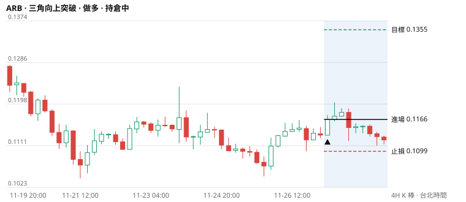

### ARB · 三角向上突破｜四段 · 做多 · 浮動 +0.22R

4H 週期｜進場 11-27 12:00 @ 0.1166｜現價 0.1181｜目前止損 0.1099｜目標 1R、2R、3R 各出 25%（已出 0 段）

### ATOM · 三角向下跌破 · 做空 · 浮動 -0.51R

4H 週期｜進場 11-27 00:00 @ 1.189｜現價 1.233｜目前止損 1.276｜目標 1.016

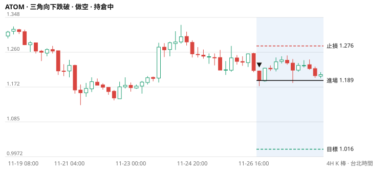

### ATOM · 三角向下跌破｜四段 · 做空 · 浮動 -0.51R

4H 週期｜進場 11-27 00:00 @ 1.189｜現價 1.233｜目前止損 1.276｜目標 1R、2R、3R 各出 25%（已出 0 段）

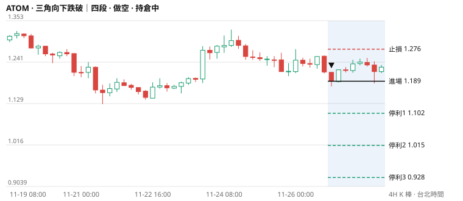

### AVAX · 三角向上突破 · 做多 · 浮動 +0.18R

4H 週期｜進場 11-27 16:00 @ 6.756｜現價 6.807｜目前止損 6.470｜目標 7.742

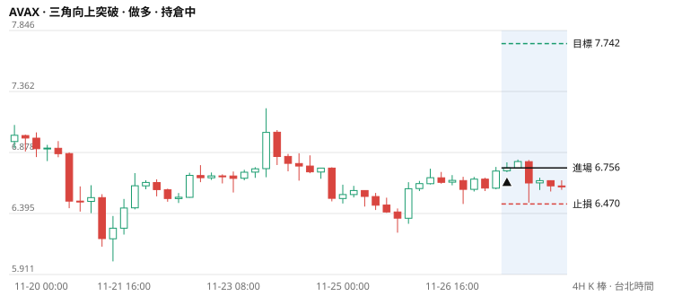

### AVAX · 三角向上突破｜四段 · 做多 · 浮動 +0.18R

4H 週期｜進場 11-27 16:00 @ 6.756｜現價 6.807｜目前止損 6.470｜目標 1R、2R、3R 各出 25%（已出 0 段）

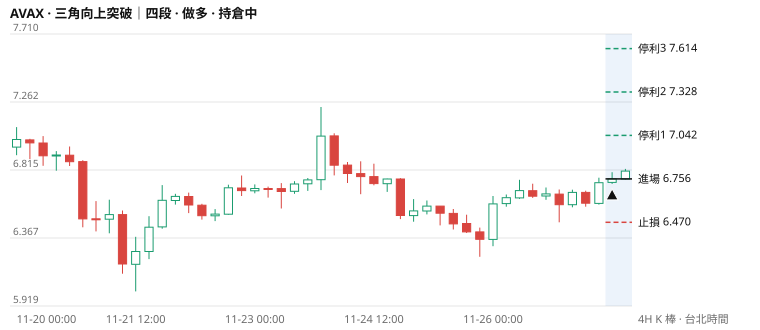

### BAT · M頭 · 做空 · 浮動 -0.51R

4H 週期｜進場 11-25 20:00 @ 0.0739｜現價 0.0786｜目前止損 0.0832｜目標 0.0654

### BAT · M頭｜四段 · 做空 · 浮動 -0.51R

4H 週期｜進場 11-25 20:00 @ 0.0739｜現價 0.0786｜目前止損 0.0832｜目標 1R、2R、3R 各出 25%（已出 0 段）

### BCH · 三角向上突破 · 做多 · 浮動 -0.43R

4H 週期｜進場 11-27 12:00 @ 216.400｜現價 211.100｜目前止損 204.200｜目標 238.800

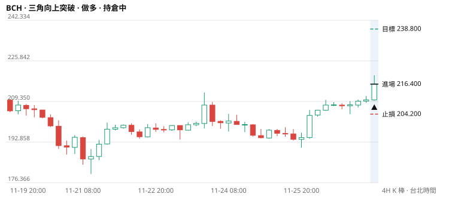

### BCH · 三角向上突破｜四段 · 做多 · 浮動 -0.43R

4H 週期｜進場 11-27 12:00 @ 216.400｜現價 211.100｜目前止損 204.200｜目標 1R、2R、3R 各出 25%（已出 0 段）

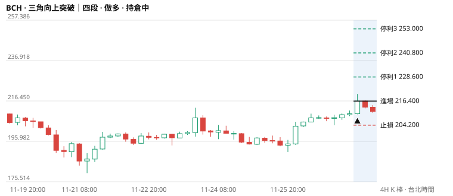

### BCH · 上升三角 · 做多 · 浮動 -0.43R

4H 週期｜進場 11-27 12:00 @ 216.400｜現價 211.100｜目前止損 204.200｜目標 238.800

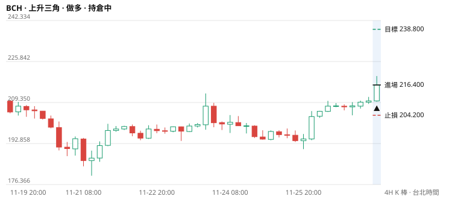

### BCH · 上升三角｜四段 · 做多 · 浮動 -0.43R

4H 週期｜進場 11-27 12:00 @ 216.400｜現價 211.100｜目前止損 204.200｜目標 1R、2R、3R 各出 25%（已出 0 段）

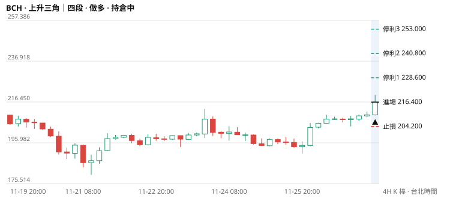

### BNB · 三角向上突破 · 做多 · 浮動 -0.05R

4H 週期｜進場 11-27 16:00 @ 565.090｜現價 564.060｜目前止損 544.610｜目標 625.730

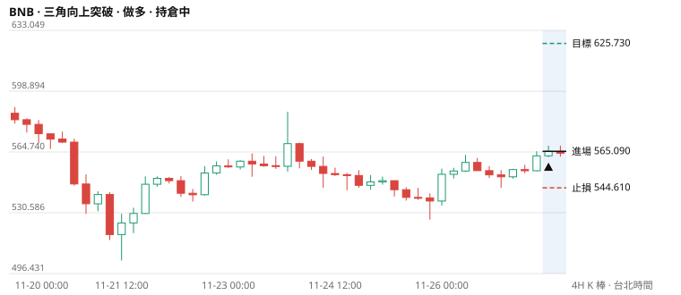

### BNB · 三角向上突破｜四段 · 做多 · 浮動 -0.05R

4H 週期｜進場 11-27 16:00 @ 565.090｜現價 564.060｜目前止損 544.610｜目標 1R、2R、3R 各出 25%（已出 0 段）

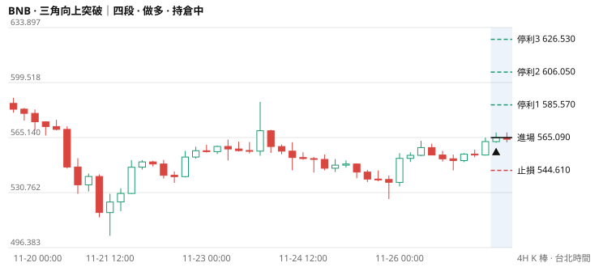

### BTC · 三角向上突破 · 做多 · 浮動 -0.01R

4H 週期｜進場 11-27 16:00 @ 61,673.4｜現價 61,662.6｜目前止損 59,915.0｜目標 68,976.2

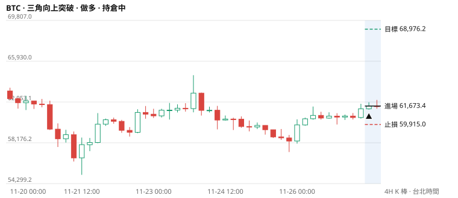

### BTC · 三角向上突破｜四段 · 做多 · 浮動 -0.01R

4H 週期｜進場 11-27 16:00 @ 61,673.4｜現價 61,662.6｜目前止損 59,915.0｜目標 1R、2R、3R 各出 25%（已出 0 段）

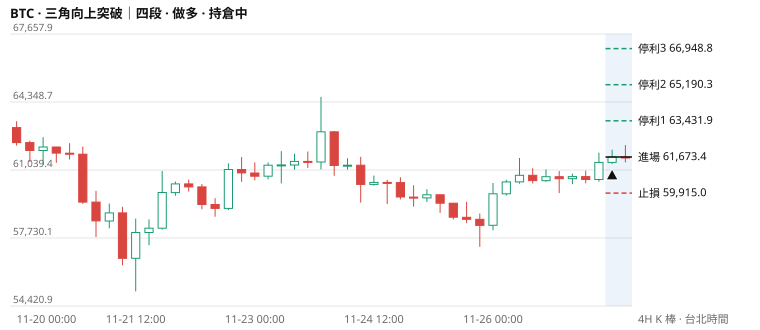

### CHZ · 三角向上突破 · 做多 · 浮動 +0.04R

4H 週期｜進場 11-27 12:00 @ 0.00916｜現價 0.00917｜目前止損 0.00888｜目標 0.01014

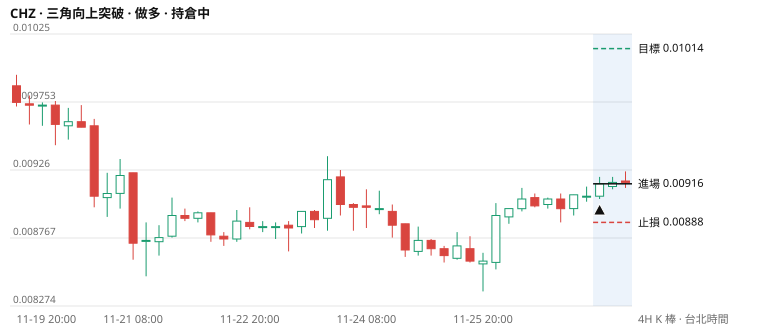

### CHZ · 三角向上突破｜四段 · 做多 · 浮動 +0.04R

4H 週期｜進場 11-27 12:00 @ 0.00916｜現價 0.00917｜目前止損 0.00888｜目標 1R、2R、3R 各出 25%（已出 0 段）

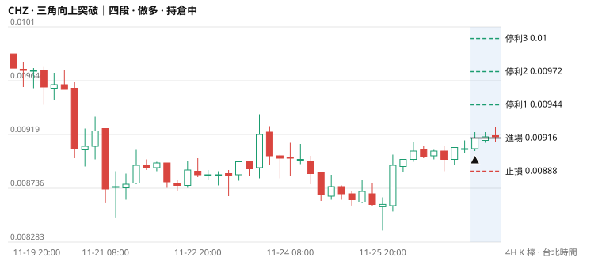

### DASH · 三角向上突破 · 做多 · 浮動 +0.00R

4H 週期｜進場 11-27 20:00 @ 36.950｜現價 36.950｜目前止損 34.950｜目標 42.140

### DASH · 三角向上突破｜四段 · 做多 · 浮動 +0.00R

4H 週期｜進場 11-27 20:00 @ 36.950｜現價 36.950｜目前止損 34.950｜目標 1R、2R、3R 各出 25%（已出 0 段）

### DASH · 多頭旗形 · 做多 · 浮動 +0.00R

4H 週期｜進場 11-27 20:00 @ 36.950｜現價 36.950｜目前止損 34.950｜目標 41.100

### DASH · 多頭旗形｜四段 · 做多 · 浮動 +0.00R

4H 週期｜進場 11-27 20:00 @ 36.950｜現價 36.950｜目前止損 34.950｜目標 1R、2R、3R 各出 25%（已出 0 段）

### ETH · 三角向上突破 · 做多 · 浮動 -0.17R

4H 週期｜進場 11-27 16:00 @ 1,735.4｜現價 1,724.0｜目前止損 1,667.9｜目標 1,971.7

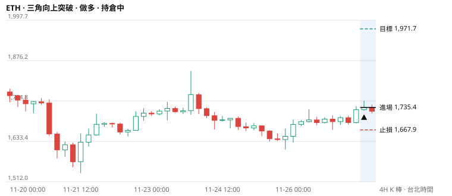

### ETH · 三角向上突破｜四段 · 做多 · 浮動 -0.17R

4H 週期｜進場 11-27 16:00 @ 1,735.4｜現價 1,724.0｜目前止損 1,667.9｜目標 1R、2R、3R 各出 25%（已出 0 段）

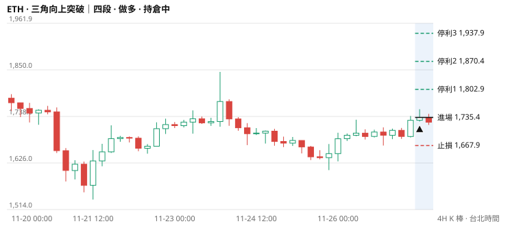

### FET · W底 · 做多 · 浮動 +0.40R

4H 週期｜進場 11-27 04:00 @ 0.1209｜現價 0.1291｜目前止損 0.1005｜目標 0.14

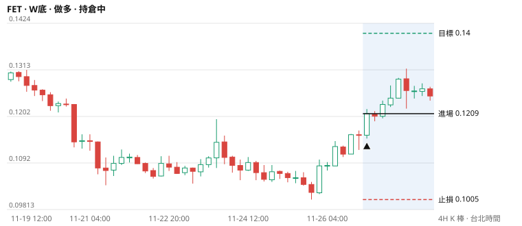

### FET · W底｜四段 · 做多 · 浮動 +0.40R

4H 週期｜進場 11-27 04:00 @ 0.1209｜現價 0.1291｜目前止損 0.1005｜目標 1R、2R、3R 各出 25%（已出 0 段）

### FET · 三重底 · 做多 · 浮動 +0.40R

4H 週期｜進場 11-27 04:00 @ 0.1209｜現價 0.1291｜目前止損 0.1005｜目標 0.14

### FET · 三重底｜四段 · 做多 · 浮動 +0.40R

4H 週期｜進場 11-27 04:00 @ 0.1209｜現價 0.1291｜目前止損 0.1005｜目標 1R、2R、3R 各出 25%（已出 0 段）

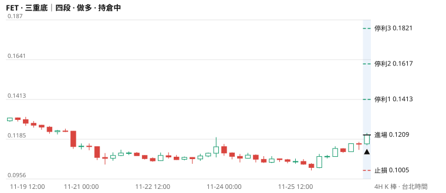

### GRT · 三角向上突破 · 做多 · 浮動 -0.06R

4H 週期｜進場 11-27 12:00 @ 0.01686｜現價 0.01682｜目前止損 0.01617｜目標 0.01954

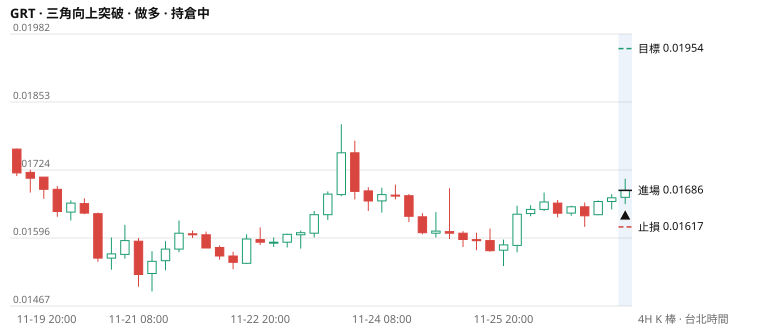

### GRT · 三角向上突破｜四段 · 做多 · 浮動 -0.06R

4H 週期｜進場 11-27 12:00 @ 0.01686｜現價 0.01682｜目前止損 0.01617｜目標 1R、2R、3R 各出 25%（已出 0 段）

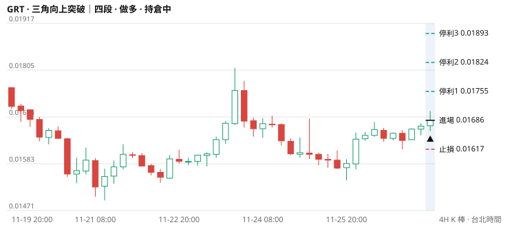

### ICP · 三角向上突破 · 做多 · 浮動 -0.21R

4H 週期｜進場 11-27 12:00 @ 2.057｜現價 2.036｜目前止損 1.957｜目標 2.308

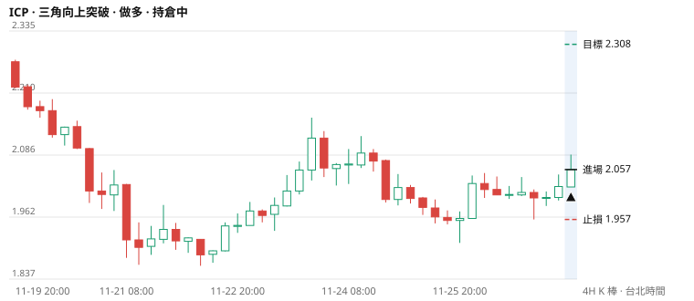

### ICP · 三角向上突破｜四段 · 做多 · 浮動 -0.21R

4H 週期｜進場 11-27 12:00 @ 2.057｜現價 2.036｜目前止損 1.957｜目標 1R、2R、3R 各出 25%（已出 0 段）

### IMX · 上升三角 · 做多 · 浮動 +0.13R

4H 週期｜進場 11-27 12:00 @ 0.0943｜現價 0.0947｜目前止損 0.0912｜目標 0.1034

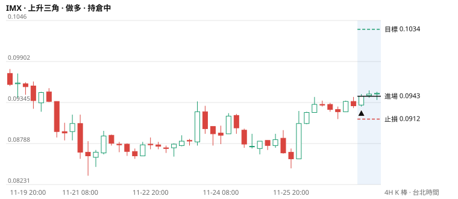

### IMX · 上升三角｜四段 · 做多 · 浮動 +0.13R

4H 週期｜進場 11-27 12:00 @ 0.0943｜現價 0.0947｜目前止損 0.0912｜目標 1R、2R、3R 各出 25%（已出 0 段）

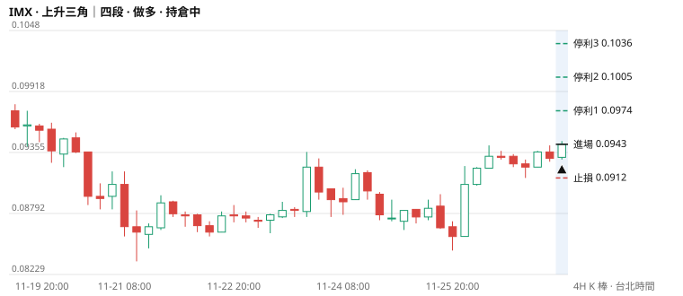

### IMX · 多頭旗形 · 做多 · 浮動 +0.13R

4H 週期｜進場 11-27 12:00 @ 0.0943｜現價 0.0947｜目前止損 0.0912｜目標 0.104

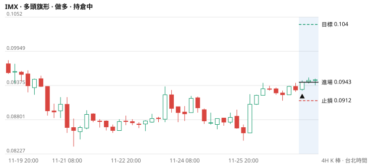

### IMX · 多頭旗形｜四段 · 做多 · 浮動 +0.13R

4H 週期｜進場 11-27 12:00 @ 0.0943｜現價 0.0947｜目前止損 0.0912｜目標 1R、2R、3R 各出 25%（已出 0 段）

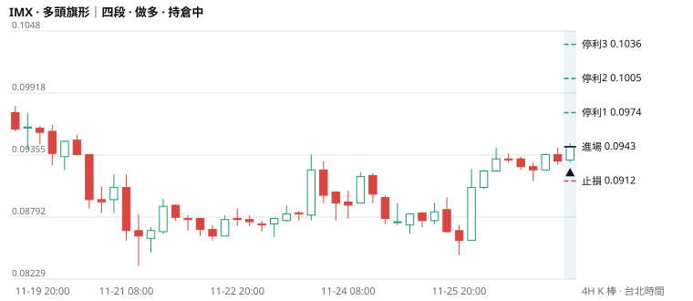

### IOTA · 三角向上突破 · 做多 · 浮動 +0.13R

4H 週期｜進場 11-27 12:00 @ 0.0327｜現價 0.0329｜目前止損 0.0312｜目標 0.0365

### IOTA · 三角向上突破｜四段 · 做多 · 浮動 +0.13R

4H 週期｜進場 11-27 12:00 @ 0.0327｜現價 0.0329｜目前止損 0.0312｜目標 1R、2R、3R 各出 25%（已出 0 段）

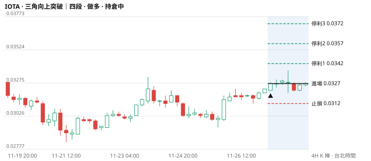

### IOTA · 多頭旗形 · 做多 · 浮動 +0.13R

4H 週期｜進場 11-27 12:00 @ 0.0327｜現價 0.0329｜目前止損 0.0312｜目標 0.0356

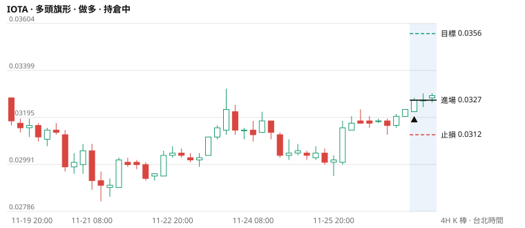

### IOTA · 多頭旗形｜四段 · 做多 · 浮動 +0.13R

4H 週期｜進場 11-27 12:00 @ 0.0327｜現價 0.0329｜目前止損 0.0312｜目標 1R、2R、3R 各出 25%（已出 0 段）

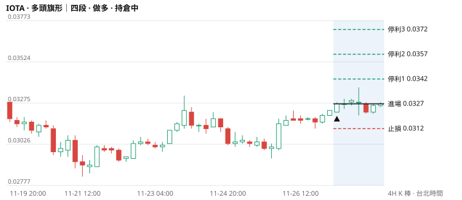

### KAVA · 三角向上突破｜四段 · 做多 · 浮動 +1.90R

4H 週期｜進場 11-27 04:00 @ 0.02488｜現價 0.02636｜目前止損 0.02523｜目標 1R、2R、3R 各出 25%（已出 3 段）

### KAVA · 三角向上突破 · 做多 · 浮動 +0.00R

4H 週期｜進場 11-27 20:00 @ 0.02636｜現價 0.02636｜目前止損 0.024｜目標 0.02841

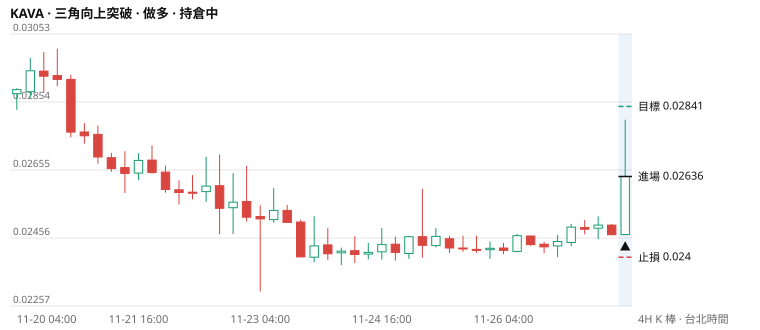

### KAVA · 三角向上突破｜四段 · 做多 · 浮動 +0.00R

4H 週期｜進場 11-27 20:00 @ 0.02636｜現價 0.02636｜目前止損 0.024｜目標 1R、2R、3R 各出 25%（已出 0 段）

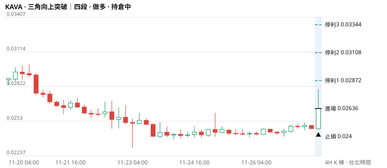

### KAVA · 三角向上突破｜強勢 · 做多 · 浮動 +0.00R

4H 週期｜進場 11-27 20:00 @ 0.02636｜現價 0.02636｜目前止損 0.024｜目標 移動止損

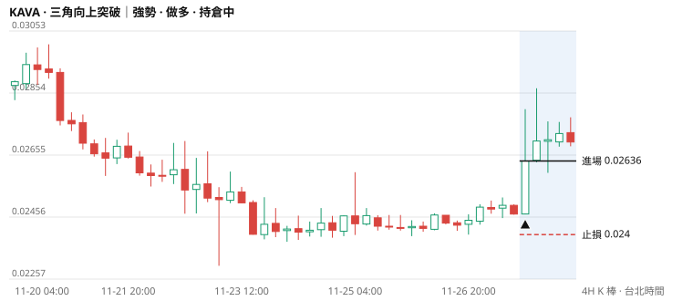

### KAVA · 三角向上突破｜強勢四段 · 做多 · 浮動 +0.00R

4H 週期｜進場 11-27 20:00 @ 0.02636｜現價 0.02636｜目前止損 0.024｜目標 1R、2R、3R 各出 25%（已出 0 段）

### LDO · 三角向上突破 · 做多 · 浮動 -0.12R

4H 週期｜進場 11-27 12:00 @ 0.242｜現價 0.2406｜目前止損 0.2306｜目標 0.2844

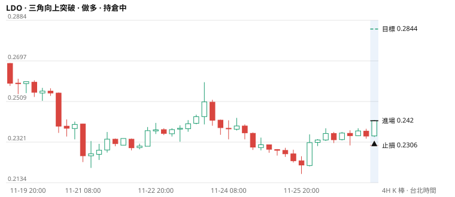

### LDO · 三角向上突破｜四段 · 做多 · 浮動 -0.12R

4H 週期｜進場 11-27 12:00 @ 0.242｜現價 0.2406｜目前止損 0.2306｜目標 1R、2R、3R 各出 25%（已出 0 段）

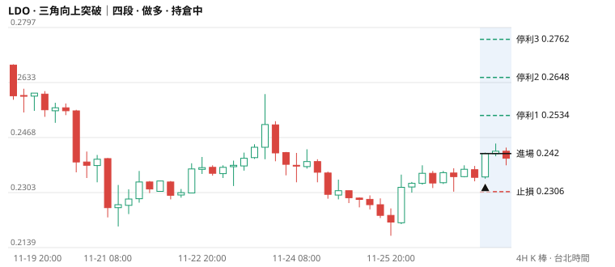

### LINK · W底 · 做多 · 浮動 -0.06R

4H 週期｜進場 11-27 16:00 @ 9.599｜現價 9.530｜目前止損 8.463｜目標 10.694

### LINK · W底｜四段 · 做多 · 浮動 -0.06R

4H 週期｜進場 11-27 16:00 @ 9.599｜現價 9.530｜目前止損 8.463｜目標 1R、2R、3R 各出 25%（已出 0 段）

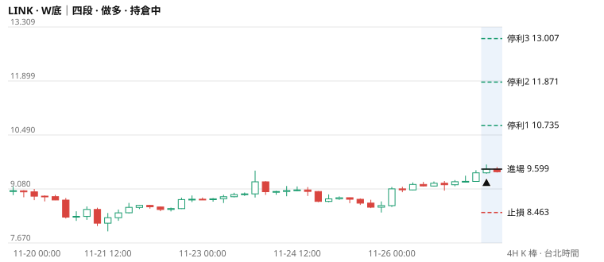

### LTC · 三角向上突破 · 做多 · 浮動 +0.19R

4H 週期｜進場 11-26 12:00 @ 43.800｜現價 44.630｜目前止損 39.500｜目標 51.180

### LTC · 三角向上突破｜四段 · 做多 · 浮動 +0.19R

4H 週期｜進場 11-26 12:00 @ 43.800｜現價 44.630｜目前止損 39.500｜目標 1R、2R、3R 各出 25%（已出 0 段）

### LTC · 上升三角 · 做多 · 浮動 +0.03R

4H 週期｜進場 11-27 12:00 @ 44.460｜現價 44.630｜目前止損 39.500｜目標 50.730

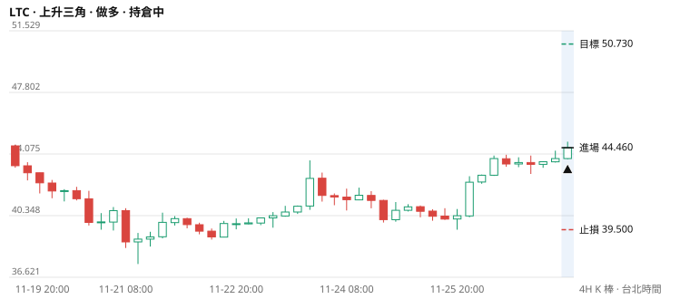

### LTC · 上升三角｜四段 · 做多 · 浮動 +0.03R

4H 週期｜進場 11-27 12:00 @ 44.460｜現價 44.630｜目前止損 39.500｜目標 1R、2R、3R 各出 25%（已出 0 段）

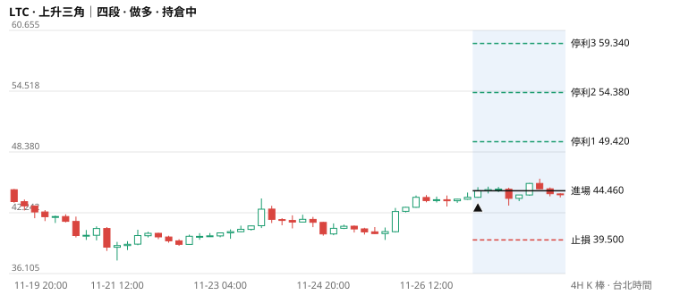

### NEO · 三角向上突破 · 做多 · 浮動 -0.29R

4H 週期｜進場 11-27 12:00 @ 1.601｜現價 1.584｜目前止損 1.543｜目標 1.801

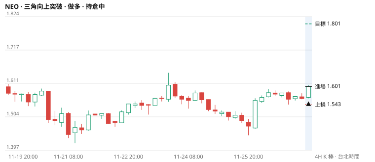

### NEO · 三角向上突破｜四段 · 做多 · 浮動 -0.29R

4H 週期｜進場 11-27 12:00 @ 1.601｜現價 1.584｜目前止損 1.543｜目標 1R、2R、3R 各出 25%（已出 0 段）

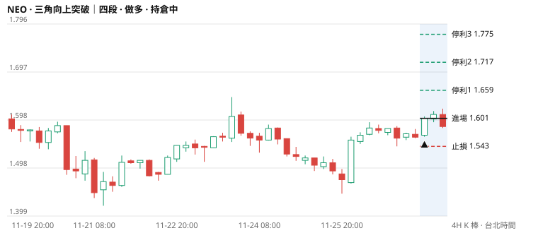

### NEO · 多頭旗形 · 做多 · 浮動 -0.29R

4H 週期｜進場 11-27 12:00 @ 1.601｜現價 1.584｜目前止損 1.543｜目標 1.749

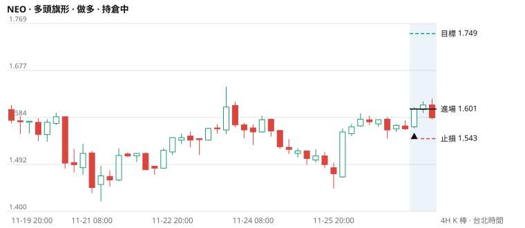

### NEO · 多頭旗形｜四段 · 做多 · 浮動 -0.29R

4H 週期｜進場 11-27 12:00 @ 1.601｜現價 1.584｜目前止損 1.543｜目標 1R、2R、3R 各出 25%（已出 0 段）

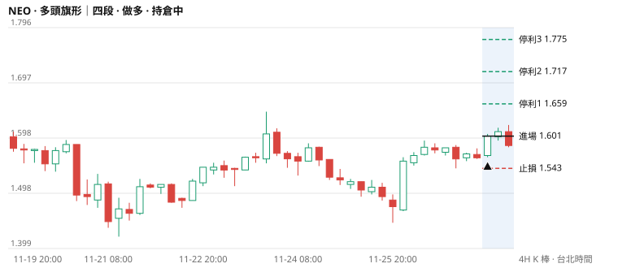

### OP · 三角向上突破 · 做多 · 浮動 +0.69R

4H 週期｜進場 11-27 12:00 @ 0.071｜現價 0.073｜目前止損 0.0681｜目標 0.0817

### OP · 三角向上突破｜四段 · 做多 · 浮動 +0.69R

4H 週期｜進場 11-27 12:00 @ 0.071｜現價 0.073｜目前止損 0.0681｜目標 1R、2R、3R 各出 25%（已出 0 段）

### QTUM · 三角向上突破 · 做多 · 浮動 -0.11R

4H 週期｜進場 11-27 12:00 @ 0.649｜現價 0.647｜目前止損 0.631｜目標 0.71

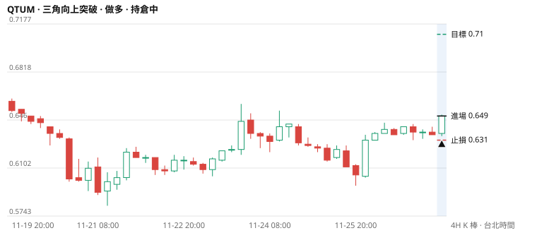

### QTUM · 三角向上突破｜四段 · 做多 · 浮動 -0.11R

4H 週期｜進場 11-27 12:00 @ 0.649｜現價 0.647｜目前止損 0.631｜目標 1R、2R、3R 各出 25%（已出 0 段）

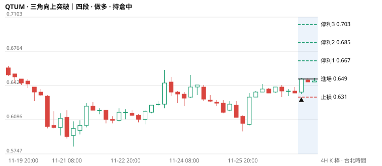

### RUNE · 頭肩底 · 做多 · 浮動 +0.83R

4H 週期｜進場 11-26 08:00 @ 0.549｜現價 0.593｜目前止損 0.496｜目標 0.6275

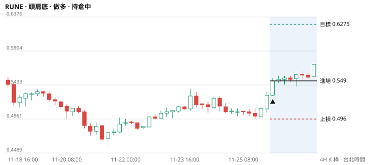

### RUNE · 頭肩底｜四段 · 做多 · 浮動 +0.83R

4H 週期｜進場 11-26 08:00 @ 0.549｜現價 0.593｜目前止損 0.496｜目標 1R、2R、3R 各出 25%（已出 0 段）

### RUNE · 上升三角 · 做多 · 浮動 +0.83R

4H 週期｜進場 11-26 08:00 @ 0.549｜現價 0.593｜目前止損 0.496｜目標 0.627

### RUNE · 上升三角｜四段 · 做多 · 浮動 +0.83R

4H 週期｜進場 11-26 08:00 @ 0.549｜現價 0.593｜目前止損 0.496｜目標 1R、2R、3R 各出 25%（已出 0 段）

### SEI · W底｜強勢｜8H · 做多 · 浮動 +0.02R

8H 週期｜進場 11-27 00:00 @ 0.03853｜現價 0.03865｜目前止損 0.03109｜目標 移動止損

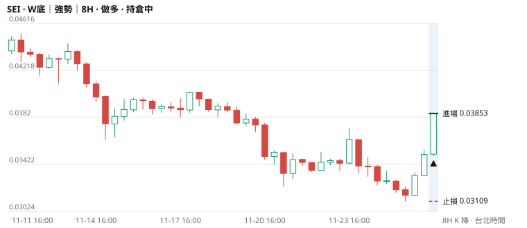

### SEI · W底｜強勢四段｜8H · 做多 · 浮動 +0.02R

8H 週期｜進場 11-27 00:00 @ 0.03853｜現價 0.03865｜目前止損 0.03109｜目標 1R、2R、3R 各出 25%（已出 0 段）

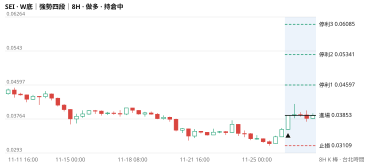

### SHIB · 三角向上突破 · 做多 · 浮動 +0.56R

4H 週期｜進場 11-27 12:00 @ 3.68e-06｜現價 3.73e-06｜目前止損 3.59e-06｜目標 4.15e-06

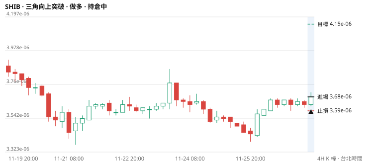

### SHIB · 三角向上突破｜四段 · 做多 · 浮動 +0.56R

4H 週期｜進場 11-27 12:00 @ 3.68e-06｜現價 3.73e-06｜目前止損 3.59e-06｜目標 1R、2R、3R 各出 25%（已出 0 段）

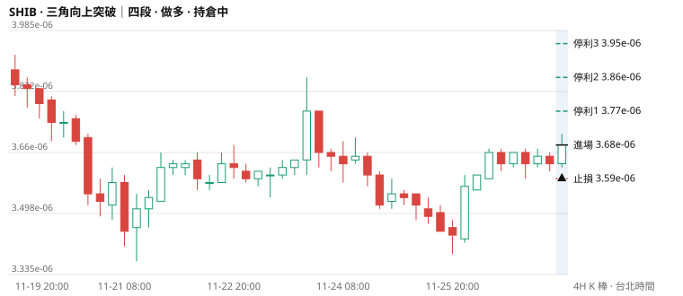

### SOL · 三角向上突破 · 做多 · 浮動 +0.14R

4H 週期｜進場 11-27 12:00 @ 72.750｜現價 73.160｜目前止損 69.710｜目標 85.390

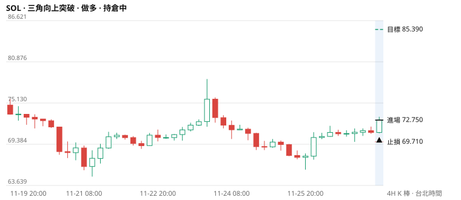

### SOL · 三角向上突破｜四段 · 做多 · 浮動 +0.14R

4H 週期｜進場 11-27 12:00 @ 72.750｜現價 73.160｜目前止損 69.710｜目標 1R、2R、3R 各出 25%（已出 0 段）

### STX · 三角向上突破 · 做多 · 浮動 +0.38R

4H 週期｜進場 11-26 04:00 @ 0.2629｜現價 0.2668｜目前止損 0.2527｜目標 0.2913

### STX · 三角向上突破｜四段 · 做多 · 浮動 +0.38R

4H 週期｜進場 11-26 04:00 @ 0.2629｜現價 0.2668｜目前止損 0.2527｜目標 1R、2R、3R 各出 25%（已出 0 段）

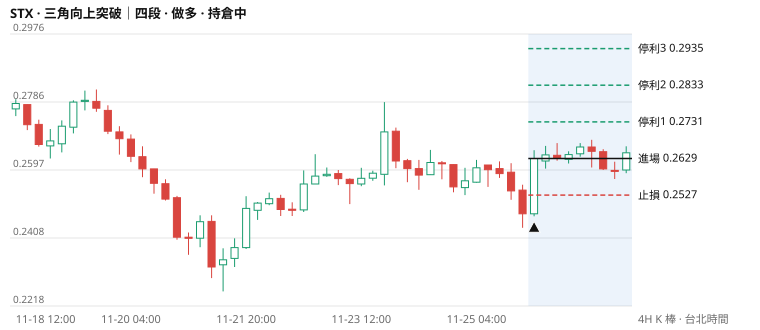

### STX · 三角向上突破｜強勢 · 做多 · 浮動 +0.38R

4H 週期｜進場 11-26 04:00 @ 0.2629｜現價 0.2668｜目前止損 0.2527｜目標 移動止損

### STX · 三角向上突破｜強勢四段 · 做多 · 浮動 +0.38R

4H 週期｜進場 11-26 04:00 @ 0.2629｜現價 0.2668｜目前止損 0.2527｜目標 1R、2R、3R 各出 25%（已出 0 段）

### SUI · 三角向上突破 · 做多 · 浮動 +0.00R

4H 週期｜進場 11-27 20:00 @ 0.6892｜現價 0.6892｜目前止損 0.6496｜目標 0.8088

### SUI · 三角向上突破｜四段 · 做多 · 浮動 +0.00R

4H 週期｜進場 11-27 20:00 @ 0.6892｜現價 0.6892｜目前止損 0.6496｜目標 1R、2R、3R 各出 25%（已出 0 段）

### SUI · 多頭旗形 · 做多 · 浮動 +0.00R

4H 週期｜進場 11-27 20:00 @ 0.6892｜現價 0.6892｜目前止損 0.6496｜目標 0.7599

### SUI · 多頭旗形｜四段 · 做多 · 浮動 +0.00R

4H 週期｜進場 11-27 20:00 @ 0.6892｜現價 0.6892｜目前止損 0.6496｜目標 1R、2R、3R 各出 25%（已出 0 段）

### UNI · 三角向上突破 · 做多 · 浮動 +0.06R

4H 週期｜進場 11-27 16:00 @ 4.885｜現價 4.905｜目前止損 4.541｜目標 5.832

### UNI · 三角向上突破｜四段 · 做多 · 浮動 +0.06R

4H 週期｜進場 11-27 16:00 @ 4.885｜現價 4.905｜目前止損 4.541｜目標 1R、2R、3R 各出 25%（已出 0 段）

### VET · 三角向上突破 · 做多 · 浮動 +0.12R

4H 週期｜進場 11-27 12:00 @ 0.004953｜現價 0.004997｜目前止損 0.004592｜目標 0.005449

### VET · 三角向上突破｜四段 · 做多 · 浮動 +0.12R

4H 週期｜進場 11-27 12:00 @ 0.004953｜現價 0.004997｜目前止損 0.004592｜目標 1R、2R、3R 各出 25%（已出 0 段）

### XRP · 三角向上突破 · 做多 · 浮動 -0.06R

4H 週期｜進場 11-27 16:00 @ 0.9786｜現價 0.9761｜目前止損 0.9338｜目標 1.116

### XRP · 三角向上突破｜四段 · 做多 · 浮動 -0.06R

4H 週期｜進場 11-27 16:00 @ 0.9786｜現價 0.9761｜目前止損 0.9338｜目標 1R、2R、3R 各出 25%（已出 0 段）

### XTZ · 頭肩底 · 做多 · 浮動 +0.24R

4H 週期｜進場 11-27 04:00 @ 0.2204｜現價 0.2243｜目前止損 0.2042｜目標 0.2487

### XTZ · 頭肩底｜四段 · 做多 · 浮動 +0.24R

4H 週期｜進場 11-27 04:00 @ 0.2204｜現價 0.2243｜目前止損 0.2042｜目標 1R、2R、3R 各出 25%（已出 0 段）

### ZIL · W底 · 做多 · 浮動 +0.03R

4H 週期｜進場 11-27 16:00 @ 0.000884｜現價 0.000887｜目前止損 0.000796｜目標 0.000966

### ZIL · W底｜四段 · 做多 · 浮動 +0.03R

4H 週期｜進場 11-27 16:00 @ 0.000884｜現價 0.000887｜目前止損 0.000796｜目標 1R、2R、3R 各出 25%（已出 0 段）

### ZIL · 箱型向上突破 · 做多 · 浮動 +0.04R

4H 週期｜進場 11-27 16:00 @ 0.000884｜現價 0.000887｜目前止損 0.000803｜目標 0.000968

### ZIL · 箱型向上突破｜四段 · 做多 · 浮動 +0.04R

4H 週期｜進場 11-27 16:00 @ 0.000884｜現價 0.000887｜目前止損 0.000803｜目標 1R、2R、3R 各出 25%（已出 0 段）

### ZRX · 三角向上突破 · 做多 · 浮動 +0.35R

4H 週期｜進場 11-27 12:00 @ 0.08｜現價 0.0806｜目前止損 0.0783｜目標 0.0873

### ZRX · 三角向上突破｜四段 · 做多 · 浮動 +0.35R

4H 週期｜進場 11-27 12:00 @ 0.08｜現價 0.0806｜目前止損 0.0783｜目標 1R、2R、3R 各出 25%（已出 0 段）

### ZRX · 多頭旗形 · 做多 · 浮動 +0.35R

4H 週期｜進場 11-27 12:00 @ 0.08｜現價 0.0806｜目前止損 0.0783｜目標 0.0864

### ZRX · 多頭旗形｜四段 · 做多 · 浮動 +0.35R

4H 週期｜進場 11-27 12:00 @ 0.08｜現價 0.0806｜目前止損 0.0783｜目標 1R、2R、3R 各出 25%（已出 0 段）

## 規則與週期比較（已結束交易）

「強勢版」和「強勢四段停利」做的是同一批進場，只有出場不同：前者全部部位用移動止損；後者在 1R、2R、3R 各出 25%，第一次停利後止損移到進場價，最後 25% 用移動止損。「原規則」和「原規則四段停利」也是同一批進場（每一個形態突破），前者目標是形態等幅，後者用同樣的四段出場。

| 組別 | 筆數 | 勝率 | 每筆平均 | 合計 |
|---|---|---|---|---|
| 4H 原規則（等幅目標） | 6 | 16.7% | -0.31R | -1.9R |
| 4H 原規則四段停利 | 5 | 0.0% | -1.02R | -5.1R |
| 4H 強勢版（移動止損） | 0 | — | — | — |
| 8H 強勢版（移動止損） | 0 | — | — | — |
| 12H 強勢版（移動止損） | 0 | — | — | — |
| 日線 強勢版（移動止損） | 0 | — | — | — |
| 4H 強勢四段停利 | 0 | — | — | — |
| 8H 強勢四段停利 | 0 | — | — | — |
| 12H 強勢四段停利 | 0 | — | — | — |
| 日線 強勢四段停利 | 0 | — | — | — |
| 全部 強勢版（移動止損） | 0 | — | — | — |
| 全部 強勢四段停利 | 0 | — | — | — |

## 最近 20 筆已結束交易

| 出場時間 | 商品 | 帳戶 | 方向 | 結果 | 出場原因 |
|---|---|---|---|---|---|
| 11-27 20:00 | KAVA | 三角向上突破 | 做多 | +3.20R | 到達目標 |
| 11-27 16:00 | GALA | 上升楔形 | 做空 | -1.01R | 止損 |
| 11-27 16:00 | GALA | 上升楔形｜四段 | 做空 | -1.01R | 止損 |
| 11-26 20:00 | BAT | 下降三角 | 做空 | -1.01R | 止損 |
| 11-26 20:00 | BAT | 下降三角｜四段 | 做空 | -1.01R | 止損 |
| 11-26 04:00 | STX | 頭肩頂 | 做空 | -1.02R | 止損 |
| 11-26 04:00 | STX | 三角向下跌破 | 做空 | -1.02R | 止損 |
| 11-26 04:00 | STX | 下降三角 | 做空 | -1.02R | 止損 |
| 11-26 04:00 | STX | 頭肩頂｜四段 | 做空 | -1.02R | 止損 |
| 11-26 04:00 | STX | 三角向下跌破｜四段 | 做空 | -1.02R | 止損 |
| 11-26 04:00 | STX | 下降三角｜四段 | 做空 | -1.02R | 止損 |

## 最近 10 筆已結束交易的圖表

黑色三角是進場，藍色三角是出場。**每一筆已結束交易的圖表都在 [TRADES.md](TRADES.md)**，依月份分頁。

### KAVA · 三角向上突破 · 做多 · +3.20R

4H 週期｜進場 11-27 04:00 @ 0.02488｜止損 0.02395｜目標 0.02788｜出場 11-27 20:00 @ 0.02788（到達目標）

### GALA · 上升楔形 · 做空 · -1.01R

4H 週期｜進場 11-25 20:00 @ 0.001251｜止損 0.001398｜目標 0.001053｜出場 11-27 16:00 @ 0.001398（止損）

### GALA · 上升楔形｜四段 · 做空 · -1.01R

4H 週期｜進場 11-25 20:00 @ 0.001251｜止損 0.001398｜目標 1R、2R、3R 各出 25%｜出場 11-27 16:00 @ 0.001398（止損）

### BAT · 下降三角 · 做空 · -1.01R

4H 週期｜進場 11-25 20:00 @ 0.0739｜止損 0.0812｜目標 0.0665｜出場 11-26 20:00 @ 0.0812（止損）

### BAT · 下降三角｜四段 · 做空 · -1.01R

4H 週期｜進場 11-25 20:00 @ 0.0739｜止損 0.0812｜目標 1R、2R、3R 各出 25%｜出場 11-26 20:00 @ 0.0812（止損）

### STX · 頭肩頂 · 做空 · -1.02R

4H 週期｜進場 11-26 00:00 @ 0.2475｜止損 0.2625｜目標 0.2203｜出場 11-26 04:00 @ 0.2625（止損）

### STX · 三角向下跌破 · 做空 · -1.02R

4H 週期｜進場 11-26 00:00 @ 0.2475｜止損 0.2625｜目標 0.2191｜出場 11-26 04:00 @ 0.2625（止損）

### STX · 下降三角 · 做空 · -1.02R

4H 週期｜進場 11-26 00:00 @ 0.2475｜止損 0.2625｜目標 0.2191｜出場 11-26 04:00 @ 0.2625（止損）

### STX · 頭肩頂｜四段 · 做空 · -1.02R

4H 週期｜進場 11-26 00:00 @ 0.2475｜止損 0.2625｜目標 1R、2R、3R 各出 25%｜出場 11-26 04:00 @ 0.2625（止損）

### STX · 三角向下跌破｜四段 · 做空 · -1.02R

4H 週期｜進場 11-26 00:00 @ 0.2475｜止損 0.2625｜目標 1R、2R、3R 各出 25%｜出場 11-26 04:00 @ 0.2625（止損）

## 各帳戶損益（只列有交易的）

| 帳戶 | 損益 USDT |
|---|---|
| 三角向上突破 | +160 |
| 上升楔形 | -51 |
| 上升楔形｜四段 | -51 |
| 頭肩頂｜四段 | -51 |
| 頭肩頂 | -51 |
| 三角向下跌破｜四段 | -51 |
| 三角向下跌破 | -51 |
| 下降三角 | -101 |
| 下降三角｜四段 | -101 |

完整互動圖表：https://ashin047.github.io/pattern-paper-bot/
