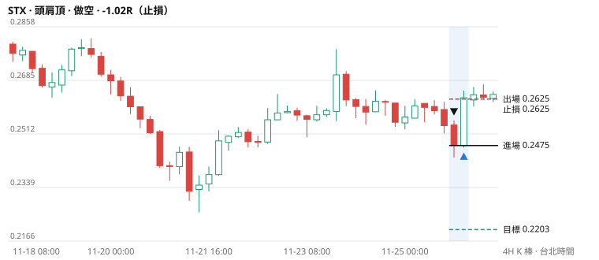
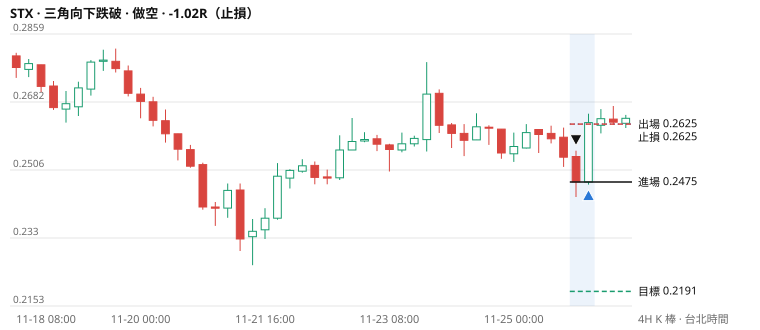
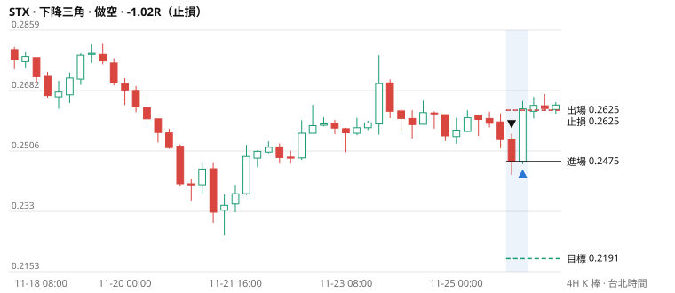

# 2026-11 已結束的交易

共 3 筆，合計 -3.1R。最新的在最上面。[回到索引](../TRADES.md)

### STX · 頭肩頂 · 做空 · -1.02R

4H 週期｜進場 11-26 00:00 @ 0.2475｜止損 0.2625｜目標 0.2203｜出場 11-26 04:00 @ 0.2625（止損）

### STX · 三角向下跌破 · 做空 · -1.02R

4H 週期｜進場 11-26 00:00 @ 0.2475｜止損 0.2625｜目標 0.2191｜出場 11-26 04:00 @ 0.2625（止損）

### STX · 下降三角 · 做空 · -1.02R

4H 週期｜進場 11-26 00:00 @ 0.2475｜止損 0.2625｜目標 0.2191｜出場 11-26 04:00 @ 0.2625（止損）

