# 2026-11 已結束的交易

共 66 筆，合計 -53.2R。最新的在最上面。[回到索引](../TRADES.md)

### KAVA · 三角向上突破｜四段 · 做多 · +2.21R

4H 週期｜進場 11-27 04:00 @ 0.02488｜止損 0.02395｜目標 1R、2R、3R 各出 25%｜出場 11-28 20:00 @ 0.02743（已停利 3 段，餘倉移動止損出場）

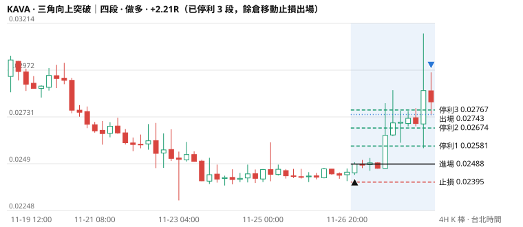

### KAVA · 三角向上突破｜四段 · 做多 · +0.98R

4H 週期｜進場 11-27 20:00 @ 0.02636｜止損 0.024｜目標 1R、2R、3R 各出 25%｜出場 11-28 20:00 @ 0.02743（已停利 2 段，餘倉移動止損出場）

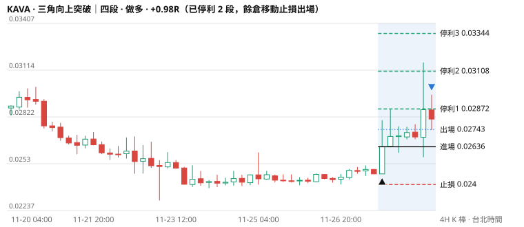

### KAVA · 三角向上突破｜強勢 · 做多 · +0.46R

4H 週期｜進場 11-27 20:00 @ 0.02636｜止損 0.024｜目標 移動止損｜出場 11-28 20:00 @ 0.02743（移動止損出場）

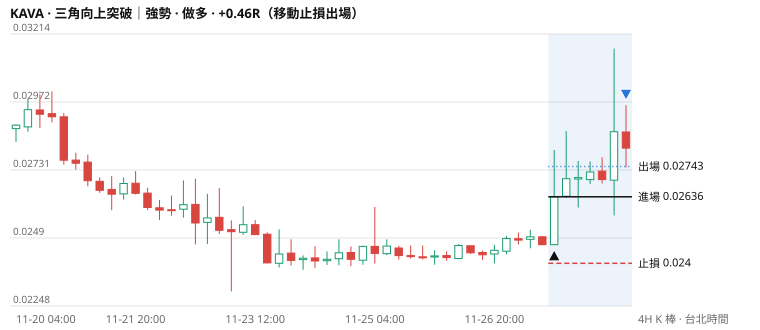

### KAVA · 三角向上突破｜強勢四段 · 做多 · +0.98R

4H 週期｜進場 11-27 20:00 @ 0.02636｜止損 0.024｜目標 1R、2R、3R 各出 25%｜出場 11-28 20:00 @ 0.02743（已停利 2 段，餘倉移動止損出場）

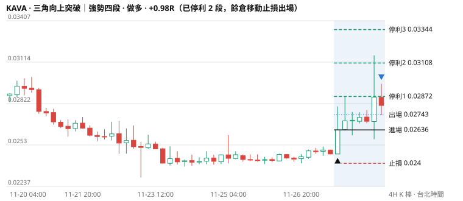

### DASH · 三角向上突破 · 做多 · -1.02R

4H 週期｜進場 11-27 20:00 @ 36.950｜止損 34.950｜目標 42.140｜出場 11-28 16:00 @ 34.950（止損）

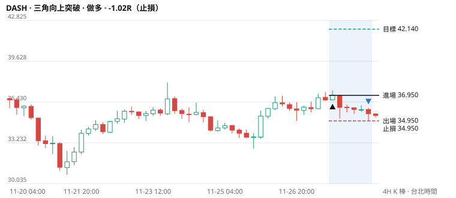

### DASH · 三角向上突破｜四段 · 做多 · -1.02R

4H 週期｜進場 11-27 20:00 @ 36.950｜止損 34.950｜目標 1R、2R、3R 各出 25%｜出場 11-28 16:00 @ 34.950（止損）

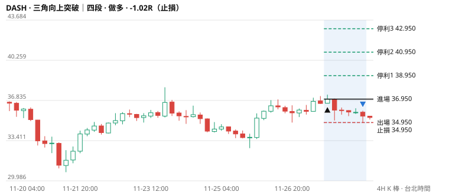

### DASH · 多頭旗形 · 做多 · -1.02R

4H 週期｜進場 11-27 20:00 @ 36.950｜止損 34.950｜目標 41.100｜出場 11-28 16:00 @ 34.950（止損）

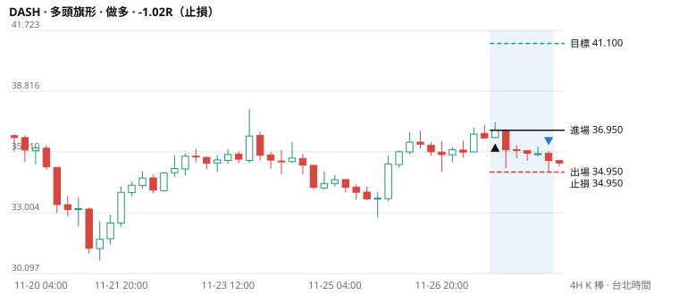

### DASH · 多頭旗形｜四段 · 做多 · -1.02R

4H 週期｜進場 11-27 20:00 @ 36.950｜止損 34.950｜目標 1R、2R、3R 各出 25%｜出場 11-28 16:00 @ 34.950（止損）

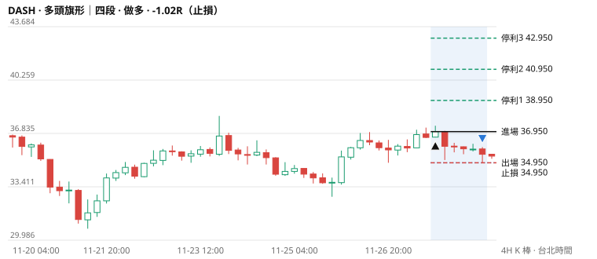

### ICP · 三角向上突破 · 做多 · -1.03R

4H 週期｜進場 11-27 12:00 @ 2.057｜止損 1.957｜目標 2.308｜出場 11-28 16:00 @ 1.957（止損）

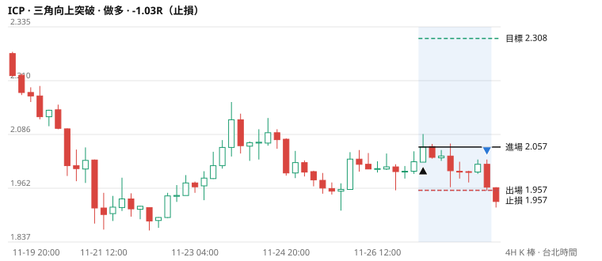

### ICP · 三角向上突破｜四段 · 做多 · -1.03R

4H 週期｜進場 11-27 12:00 @ 2.057｜止損 1.957｜目標 1R、2R、3R 各出 25%｜出場 11-28 16:00 @ 1.957（止損）

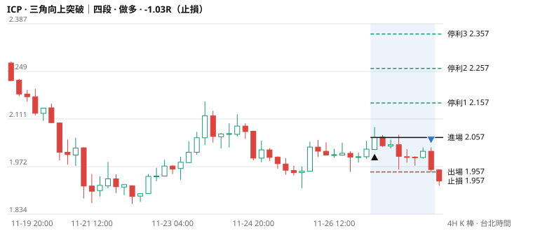

### SNX · 三角向上突破 · 做多 · -1.03R

4H 週期｜進場 11-28 08:00 @ 0.1482｜止損 0.1407｜目標 0.1771｜出場 11-28 16:00 @ 0.1407（止損）

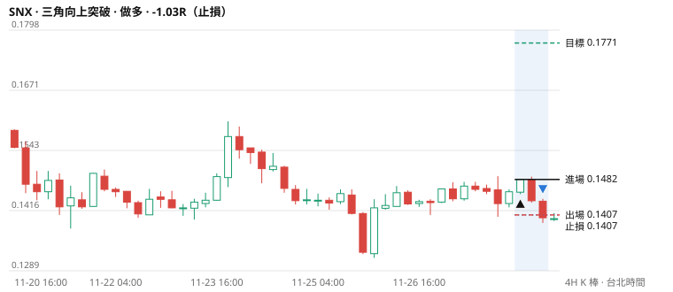

### SNX · 三角向上突破｜四段 · 做多 · -1.03R

4H 週期｜進場 11-28 08:00 @ 0.1482｜止損 0.1407｜目標 1R、2R、3R 各出 25%｜出場 11-28 16:00 @ 0.1407（止損）

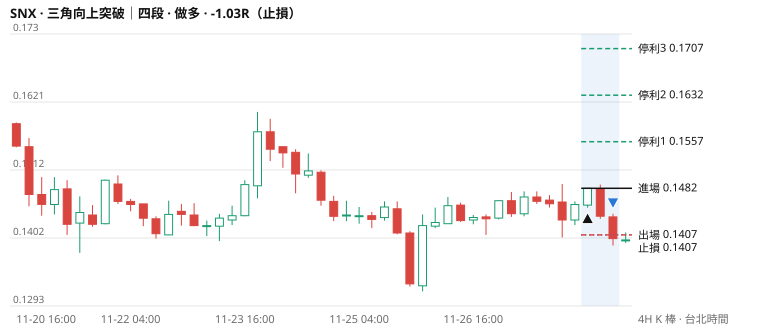

### STX · 上升楔形 · 做空 · -1.02R

4H 週期｜進場 11-28 00:00 @ 0.2531｜止損 0.2681｜目標 0.2342｜出場 11-28 12:00 @ 0.2681（止損）

### STX · 上升楔形｜四段 · 做空 · -1.02R

4H 週期｜進場 11-28 00:00 @ 0.2531｜止損 0.2681｜目標 1R、2R、3R 各出 25%｜出場 11-28 12:00 @ 0.2681（止損）

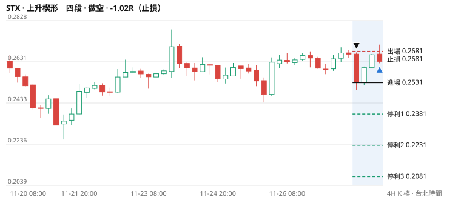

### STX · 上升楔形｜強勢 · 做空 · -1.02R

4H 週期｜進場 11-28 00:00 @ 0.2531｜止損 0.2681｜目標 移動止損｜出場 11-28 12:00 @ 0.2681（止損）

### STX · 上升楔形｜強勢四段 · 做空 · -1.02R

4H 週期｜進場 11-28 00:00 @ 0.2531｜止損 0.2681｜目標 1R、2R、3R 各出 25%｜出場 11-28 12:00 @ 0.2681（止損）

### BCH · 三角向上突破 · 做多 · -1.02R

4H 週期｜進場 11-27 12:00 @ 216.400｜止損 204.200｜目標 238.800｜出場 11-28 00:00 @ 204.200（止損）

### BCH · 三角向上突破｜四段 · 做多 · -1.02R

4H 週期｜進場 11-27 12:00 @ 216.400｜止損 204.200｜目標 1R、2R、3R 各出 25%｜出場 11-28 00:00 @ 204.200（止損）

### BCH · 上升三角 · 做多 · -1.02R

4H 週期｜進場 11-27 12:00 @ 216.400｜止損 204.200｜目標 238.800｜出場 11-28 00:00 @ 204.200（止損）

### BCH · 上升三角｜四段 · 做多 · -1.02R

4H 週期｜進場 11-27 12:00 @ 216.400｜止損 204.200｜目標 1R、2R、3R 各出 25%｜出場 11-28 00:00 @ 204.200（止損）

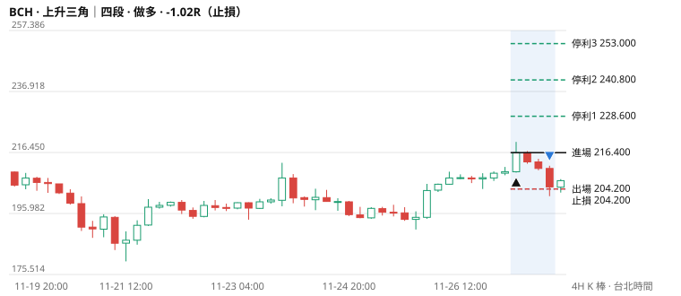

### BNB · 三角向上突破 · 做多 · -1.04R

4H 週期｜進場 11-27 16:00 @ 565.090｜止損 544.610｜目標 625.730｜出場 11-28 00:00 @ 544.610（止損）

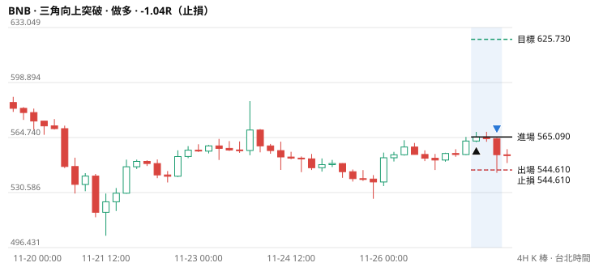

### BNB · 三角向上突破｜四段 · 做多 · -1.04R

4H 週期｜進場 11-27 16:00 @ 565.090｜止損 544.610｜目標 1R、2R、3R 各出 25%｜出場 11-28 00:00 @ 544.610（止損）

### BTC · 三角向上突破 · 做多 · -1.04R

4H 週期｜進場 11-27 16:00 @ 61,673.4｜止損 59,915.0｜目標 68,976.2｜出場 11-28 00:00 @ 59,915.0（止損）

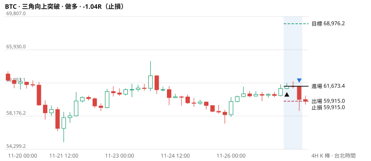

### BTC · 三角向上突破｜四段 · 做多 · -1.04R

4H 週期｜進場 11-27 16:00 @ 61,673.4｜止損 59,915.0｜目標 1R、2R、3R 各出 25%｜出場 11-28 00:00 @ 59,915.0（止損）

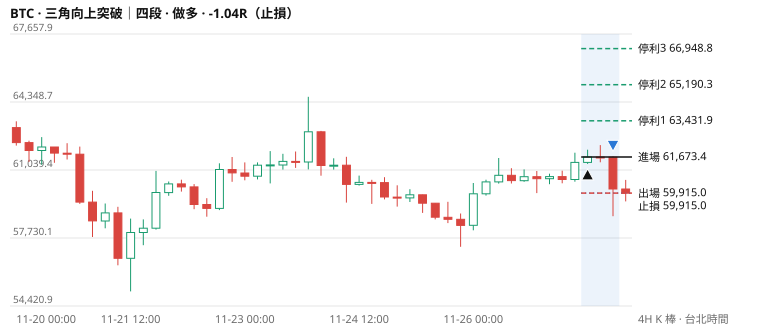

### CHZ · 三角向上突破 · 做多 · -1.05R

4H 週期｜進場 11-27 12:00 @ 0.00916｜止損 0.00888｜目標 0.01014｜出場 11-28 00:00 @ 0.00888（止損）

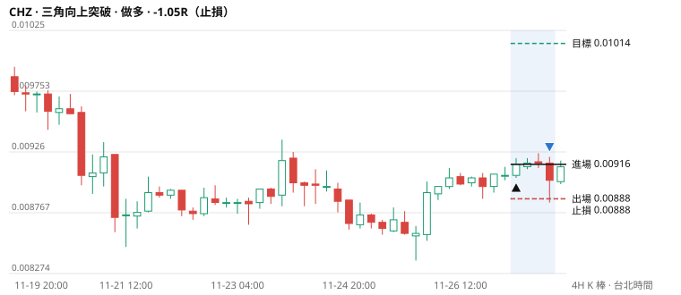

### CHZ · 三角向上突破｜四段 · 做多 · -1.05R

4H 週期｜進場 11-27 12:00 @ 0.00916｜止損 0.00888｜目標 1R、2R、3R 各出 25%｜出場 11-28 00:00 @ 0.00888（止損）

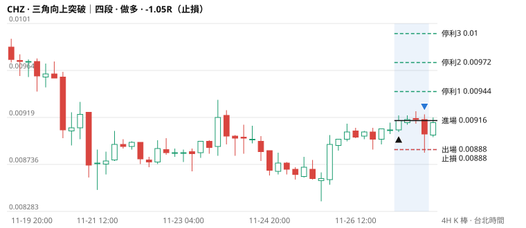

### ETH · 三角向上突破 · 做多 · -1.03R

4H 週期｜進場 11-27 16:00 @ 1,735.4｜止損 1,667.9｜目標 1,971.7｜出場 11-28 00:00 @ 1,667.9（止損）

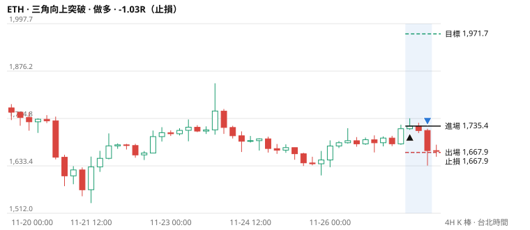

### ETH · 三角向上突破｜四段 · 做多 · -1.03R

4H 週期｜進場 11-27 16:00 @ 1,735.4｜止損 1,667.9｜目標 1R、2R、3R 各出 25%｜出場 11-28 00:00 @ 1,667.9（止損）

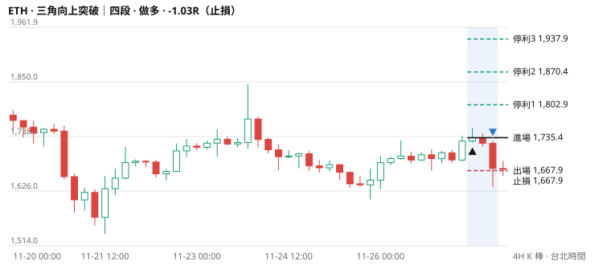

### GRT · 三角向上突破 · 做多 · -1.03R

4H 週期｜進場 11-27 12:00 @ 0.01686｜止損 0.01617｜目標 0.01954｜出場 11-28 00:00 @ 0.01617（止損）

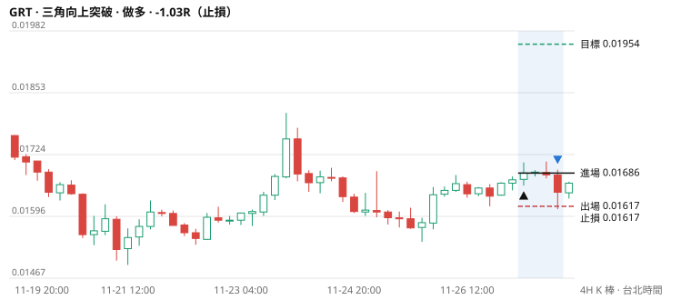

### GRT · 三角向上突破｜四段 · 做多 · -1.03R

4H 週期｜進場 11-27 12:00 @ 0.01686｜止損 0.01617｜目標 1R、2R、3R 各出 25%｜出場 11-28 00:00 @ 0.01617（止損）

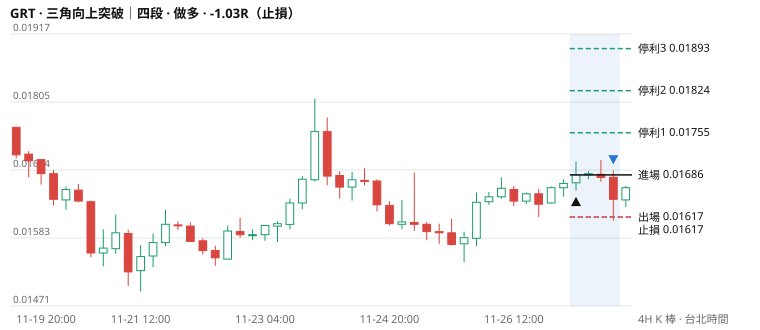

### IMX · 上升三角 · 做多 · -1.04R

4H 週期｜進場 11-27 12:00 @ 0.0943｜止損 0.0912｜目標 0.1034｜出場 11-28 00:00 @ 0.0912（止損）

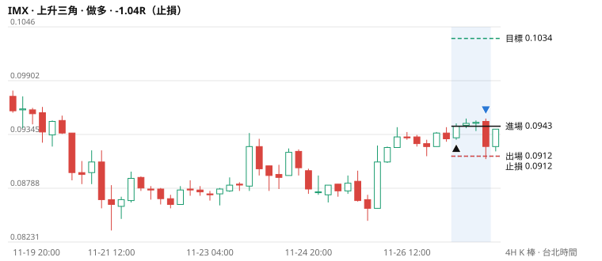

### IMX · 上升三角｜四段 · 做多 · -1.04R

4H 週期｜進場 11-27 12:00 @ 0.0943｜止損 0.0912｜目標 1R、2R、3R 各出 25%｜出場 11-28 00:00 @ 0.0912（止損）

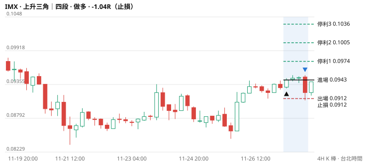

### IMX · 多頭旗形 · 做多 · -1.04R

4H 週期｜進場 11-27 12:00 @ 0.0943｜止損 0.0912｜目標 0.104｜出場 11-28 00:00 @ 0.0912（止損）

### IMX · 多頭旗形｜四段 · 做多 · -1.04R

4H 週期｜進場 11-27 12:00 @ 0.0943｜止損 0.0912｜目標 1R、2R、3R 各出 25%｜出場 11-28 00:00 @ 0.0912（止損）

### KAVA · 三角向上突破 · 做多 · +0.86R

4H 週期｜進場 11-27 20:00 @ 0.02636｜止損 0.024｜目標 0.02841｜出場 11-28 00:00 @ 0.02841（到達目標）

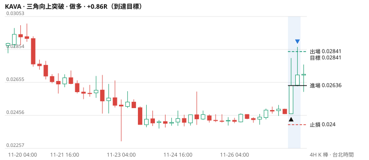

### LDO · 三角向上突破 · 做多 · -1.03R

4H 週期｜進場 11-27 12:00 @ 0.242｜止損 0.2306｜目標 0.2844｜出場 11-28 00:00 @ 0.2306（止損）

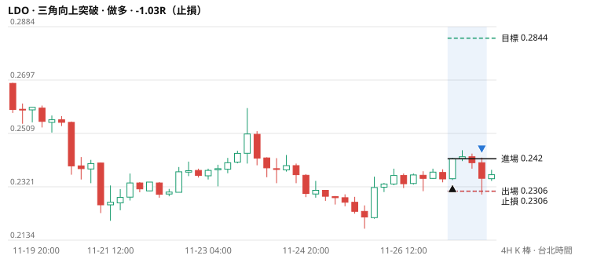

### LDO · 三角向上突破｜四段 · 做多 · -1.03R

4H 週期｜進場 11-27 12:00 @ 0.242｜止損 0.2306｜目標 1R、2R、3R 各出 25%｜出場 11-28 00:00 @ 0.2306（止損）

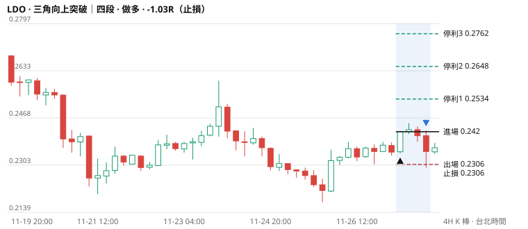

### NEO · 三角向上突破 · 做多 · -1.04R

4H 週期｜進場 11-27 12:00 @ 1.601｜止損 1.543｜目標 1.801｜出場 11-28 00:00 @ 1.543（止損）

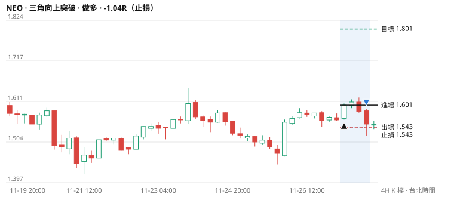

### NEO · 三角向上突破｜四段 · 做多 · -1.04R

4H 週期｜進場 11-27 12:00 @ 1.601｜止損 1.543｜目標 1R、2R、3R 各出 25%｜出場 11-28 00:00 @ 1.543（止損）

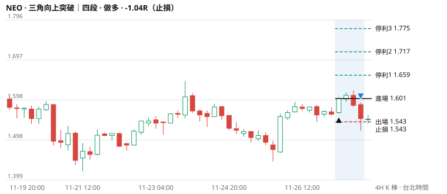

### NEO · 多頭旗形 · 做多 · -1.04R

4H 週期｜進場 11-27 12:00 @ 1.601｜止損 1.543｜目標 1.749｜出場 11-28 00:00 @ 1.543（止損）

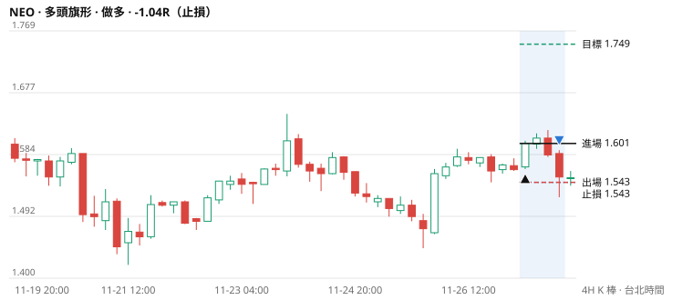

### NEO · 多頭旗形｜四段 · 做多 · -1.04R

4H 週期｜進場 11-27 12:00 @ 1.601｜止損 1.543｜目標 1R、2R、3R 各出 25%｜出場 11-28 00:00 @ 1.543（止損）

### QTUM · 三角向上突破 · 做多 · -1.04R

4H 週期｜進場 11-27 12:00 @ 0.649｜止損 0.631｜目標 0.71｜出場 11-28 00:00 @ 0.631（止損）

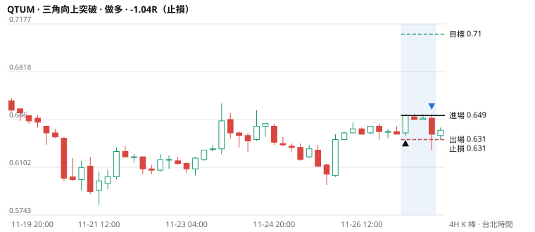

### QTUM · 三角向上突破｜四段 · 做多 · -1.04R

4H 週期｜進場 11-27 12:00 @ 0.649｜止損 0.631｜目標 1R、2R、3R 各出 25%｜出場 11-28 00:00 @ 0.631（止損）

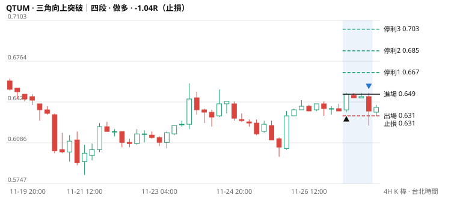

### SHIB · 三角向上突破 · 做多 · -1.06R

4H 週期｜進場 11-27 12:00 @ 3.68e-06｜止損 3.59e-06｜目標 4.15e-06｜出場 11-28 00:00 @ 3.59e-06（止損）

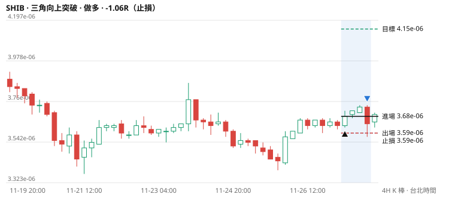

### SHIB · 三角向上突破｜四段 · 做多 · -1.06R

4H 週期｜進場 11-27 12:00 @ 3.68e-06｜止損 3.59e-06｜目標 1R、2R、3R 各出 25%｜出場 11-28 00:00 @ 3.59e-06（止損）

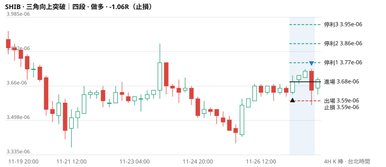

### STX · 三角向上突破 · 做多 · -1.03R

4H 週期｜進場 11-26 04:00 @ 0.2629｜止損 0.2527｜目標 0.2913｜出場 11-28 00:00 @ 0.2527（止損）

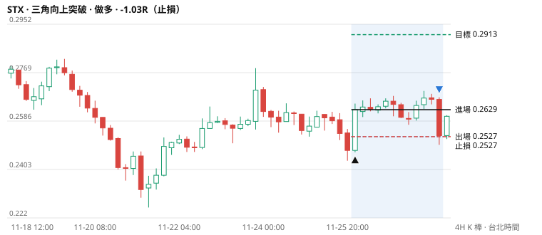

### STX · 三角向上突破｜四段 · 做多 · -1.03R

4H 週期｜進場 11-26 04:00 @ 0.2629｜止損 0.2527｜目標 1R、2R、3R 各出 25%｜出場 11-28 00:00 @ 0.2527（止損）

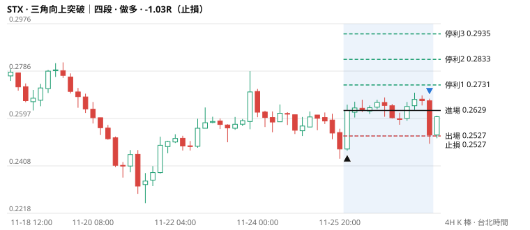

### STX · 三角向上突破｜強勢 · 做多 · -1.03R

4H 週期｜進場 11-26 04:00 @ 0.2629｜止損 0.2527｜目標 移動止損｜出場 11-28 00:00 @ 0.2527（止損）

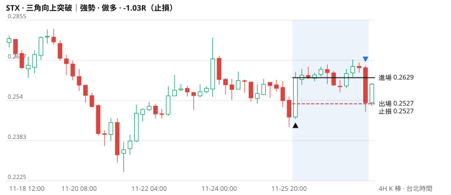

### STX · 三角向上突破｜強勢四段 · 做多 · -1.03R

4H 週期｜進場 11-26 04:00 @ 0.2629｜止損 0.2527｜目標 1R、2R、3R 各出 25%｜出場 11-28 00:00 @ 0.2527（止損）

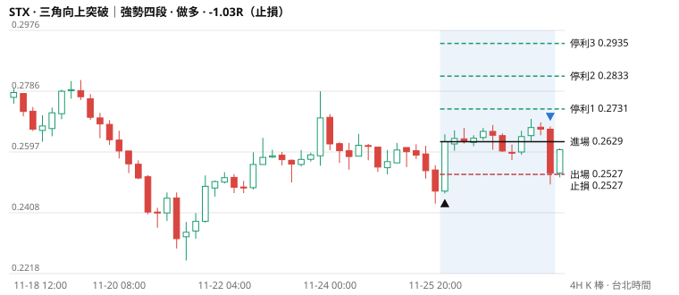

### XRP · 三角向上突破 · 做多 · -1.03R

4H 週期｜進場 11-27 16:00 @ 0.9786｜止損 0.9338｜目標 1.116｜出場 11-28 00:00 @ 0.9338（止損）

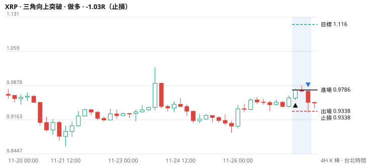

### XRP · 三角向上突破｜四段 · 做多 · -1.03R

4H 週期｜進場 11-27 16:00 @ 0.9786｜止損 0.9338｜目標 1R、2R、3R 各出 25%｜出場 11-28 00:00 @ 0.9338（止損）

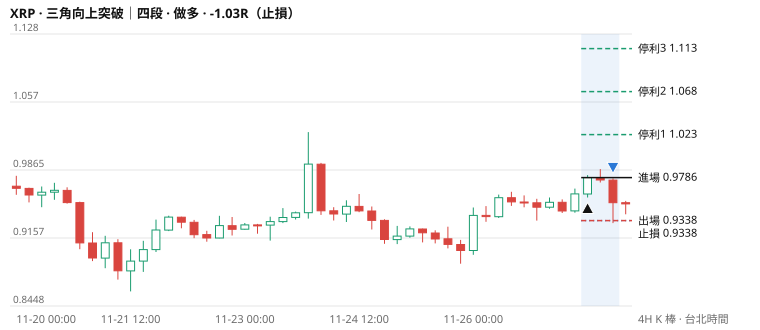

### ZRX · 三角向上突破 · 做多 · -1.06R

4H 週期｜進場 11-27 12:00 @ 0.08｜止損 0.0783｜目標 0.0873｜出場 11-28 00:00 @ 0.0783（止損）

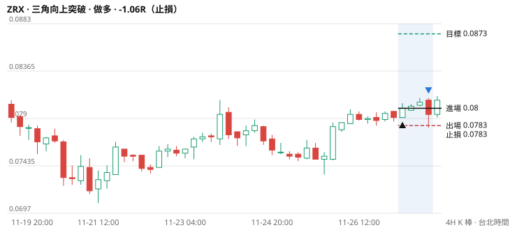

### ZRX · 三角向上突破｜四段 · 做多 · -1.06R

4H 週期｜進場 11-27 12:00 @ 0.08｜止損 0.0783｜目標 1R、2R、3R 各出 25%｜出場 11-28 00:00 @ 0.0783（止損）

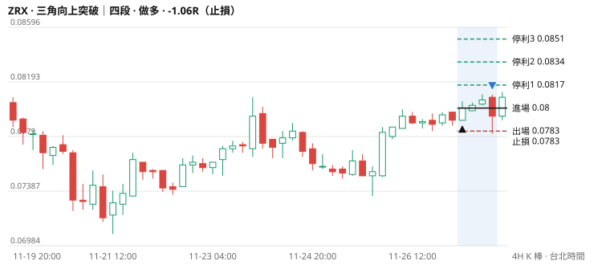

### ZRX · 多頭旗形 · 做多 · -1.06R

4H 週期｜進場 11-27 12:00 @ 0.08｜止損 0.0783｜目標 0.0864｜出場 11-28 00:00 @ 0.0783（止損）

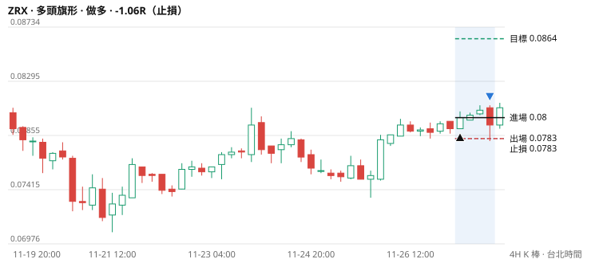

### ZRX · 多頭旗形｜四段 · 做多 · -1.06R

4H 週期｜進場 11-27 12:00 @ 0.08｜止損 0.0783｜目標 1R、2R、3R 各出 25%｜出場 11-28 00:00 @ 0.0783（止損）

### KAVA · 三角向上突破 · 做多 · +3.20R

4H 週期｜進場 11-27 04:00 @ 0.02488｜止損 0.02395｜目標 0.02788｜出場 11-27 20:00 @ 0.02788（到達目標）

### GALA · 上升楔形 · 做空 · -1.01R

4H 週期｜進場 11-25 20:00 @ 0.001251｜止損 0.001398｜目標 0.001053｜出場 11-27 16:00 @ 0.001398（止損）

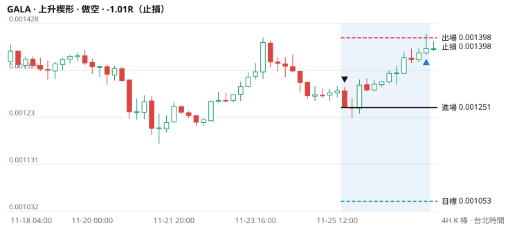

### GALA · 上升楔形｜四段 · 做空 · -1.01R

4H 週期｜進場 11-25 20:00 @ 0.001251｜止損 0.001398｜目標 1R、2R、3R 各出 25%｜出場 11-27 16:00 @ 0.001398（止損）

### BAT · 下降三角 · 做空 · -1.01R

4H 週期｜進場 11-25 20:00 @ 0.0739｜止損 0.0812｜目標 0.0665｜出場 11-26 20:00 @ 0.0812（止損）

### BAT · 下降三角｜四段 · 做空 · -1.01R

4H 週期｜進場 11-25 20:00 @ 0.0739｜止損 0.0812｜目標 1R、2R、3R 各出 25%｜出場 11-26 20:00 @ 0.0812（止損）

### STX · 頭肩頂 · 做空 · -1.02R

4H 週期｜進場 11-26 00:00 @ 0.2475｜止損 0.2625｜目標 0.2203｜出場 11-26 04:00 @ 0.2625（止損）

### STX · 三角向下跌破 · 做空 · -1.02R

4H 週期｜進場 11-26 00:00 @ 0.2475｜止損 0.2625｜目標 0.2191｜出場 11-26 04:00 @ 0.2625（止損）

### STX · 下降三角 · 做空 · -1.02R

4H 週期｜進場 11-26 00:00 @ 0.2475｜止損 0.2625｜目標 0.2191｜出場 11-26 04:00 @ 0.2625（止損）

### STX · 頭肩頂｜四段 · 做空 · -1.02R

4H 週期｜進場 11-26 00:00 @ 0.2475｜止損 0.2625｜目標 1R、2R、3R 各出 25%｜出場 11-26 04:00 @ 0.2625（止損）

### STX · 三角向下跌破｜四段 · 做空 · -1.02R

4H 週期｜進場 11-26 00:00 @ 0.2475｜止損 0.2625｜目標 1R、2R、3R 各出 25%｜出場 11-26 04:00 @ 0.2625（止損）

### STX · 下降三角｜四段 · 做空 · -1.02R

4H 週期｜進場 11-26 00:00 @ 0.2475｜止損 0.2625｜目標 1R、2R、3R 各出 25%｜出場 11-26 04:00 @ 0.2625（止損）

